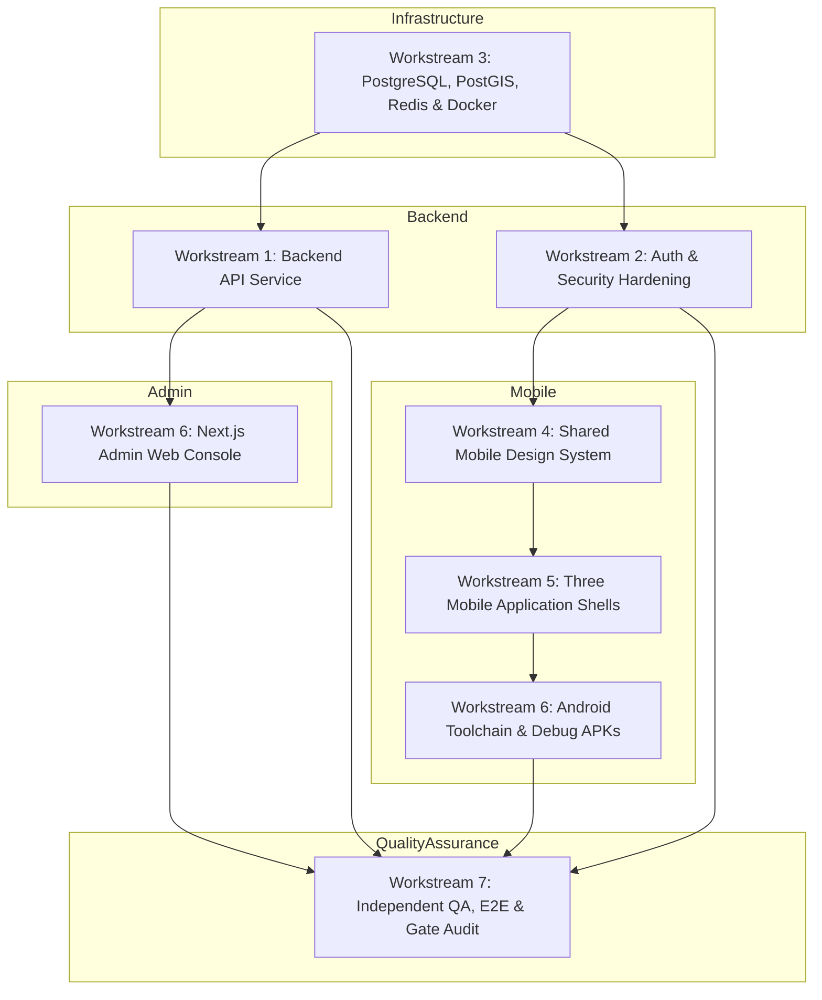

# ALLGO — PHASE 1 MASTER ENGINEERING EXECUTION PLAN

**Document ID:** `ALLGO-PHASE1-EXEC-PLAN-V1`  
**Target Repository:** `E:\allgo`  
**Git Branch:** `master`  
**Verified Baseline Commit:** `5fe64927af3c97a37ae7b3da973761ec2ac54f91`  
**Project:** AllGo — India Multi-Vertical Super App  
**Scope:** Phase 1 Authentication, Local Infrastructure, Admin Console Foundation, Three Independent Mobile App Shells, and Native Android Debug APK Generation.

---

## 1. EXECUTIVE SUMMARY

This engineering execution plan establishes the definitive, rigorous roadmap to complete **AllGo Phase 1** with production-grade reliability, real local infrastructure integrations, verified security posture, and zero simulated fallbacks.

AllGo Phase 1 is designed under strict **Zero-Cloud-Cost** and **Android-First** constraints:
1. **Host Isolation:** The host Windows machine remains unpolluted; all Flutter SDK operations, static analysis, test runners, and Android builds run strictly inside Docker (`ghcr.io/cirruslabs/flutter:3.24.5`).
2. **Phase 0 Integrity:** All architecture decisions, OpenAPI 3.1 contracts, WebSocket specifications, and database schemas created during Phase 0 remain **100% frozen and untouched**.
3. **Three Decoupled Mobile Applications:**
   - **Customer Super App:** `apps/customer_mobile` (`in.allgo.customer`)
   - **Delivery Partner App:** `apps/partner_mobile` (`in.allgo.partner`)
   - **Merchant Business App:** `apps/merchant_mobile` (`in.allgo.merchant`)
   - Supported by shared foundation package `packages/mobile_shared` (`allgo_mobile_shared`).
4. **Authoritative Backend Security:** Asymmetric RS256 JWT access tokens, Redis-backed single-use refresh token rotation (RFC 6819), cryptographic rate-limiting, and PostgreSQL authoritative role validation (`RolesGuard`).
5. **Real Infrastructure:** Real PostgreSQL 16.4 + PostGIS 3.4 and Redis 7.0 running in Docker Desktop containers.
6. **Android Build Blocker Resolution:** Resolves the Gradle 8.3 download failure by pre-populating and verifying the official distribution into the persistent Gradle cache volume, producing genuine debug APKs for all three applications.

---

## 2. REPOSITORY AUDIT & CURRENT STATE

### 2.1 Git Forensic Baseline
- **Current Branch:** `master`
- **HEAD Commit:** `5fe64927af3c97a37ae7b3da973761ec2ac54f91` (`feat(phase-1): implement local nestjs auth, user foundation, docker compose, four application shells, and test suite`)
- **Working Tree State:** Dirty (modified tracked files and untracked files from Phase 1 iterations and partial Phase 2 exploration).
- **Phase 0 Audit:** Confirmed **0 files modified** across `docs/`, `infra/terraform/`, `database/migrations/`, `database/seeds/`, or `scripts/cost-calculator.ts`.

### 2.2 Working-Tree Scope Classification
| Category | File Paths | Action / Policy |
| :--- | :--- | :--- |
| **Phase 1 Backend** | `apps/api/src/auth/`, `apps/api/src/users/`, `apps/api/src/redis/`, `apps/api/src/database/`, `apps/api/src/health/` | Scope of Phase 1 Verification |
| **Phase 1 Admin** | `apps/admin/src/app/login/`, `apps/admin/src/app/admin/users/`, `apps/admin/src/lib/` | Scope of Phase 1 Verification |
| **Phase 1 Mobile Shared** | `packages/mobile_shared/lib/` (theme, widgets, models, state, storage) | Scope of Phase 1 Verification |
| **Phase 1 Mobile Apps** | `apps/customer_mobile/`, `apps/partner_mobile/`, `apps/merchant_mobile/` | Scope of Phase 1 Verification |
| **Phase 2 In-Progress** | `apps/admin/src/app/admin/merchants/`, `apps/api/src/merchant/`, `tests/backend/merchant-lifecycle.spec.ts`, `tests/mobile/merchant-mobile.spec.ts`, `packages/mobile_shared/lib/src/models/merchant_dashboard_data.dart`, `merchant_order.dart`, `merchant_profile.dart`, `product_item.dart` | **PRESERVED IN PLACE** — kept compile-clean but excluded from Phase 1 gate |

### 2.3 Completed Requirements vs. Remaining Gaps
- **Completed:**
  - PostgreSQL 16.4 + PostGIS 3.4 container running and healthy.
  - Redis 7.0 container running and healthy.
  - Database schema migrations (`001_initial_schema.sql`, `002_postgis_indexes.sql`) applied.
  - Chennai pilot zone spatial seeds applied (`dev_seed_chennai.sql`).
  - 261/261 backend tests passing (`npm test`).
  - NestJS API compiles cleanly (`npm run build -w @allgo/api`).
  - Next.js Admin compiles cleanly (`npm run build -w @allgo/admin`).
  - Flutter SDK 3.24.5 & Dart 3.5.4 verified inside Docker with all Android licenses accepted.
  - Flutter static analysis clean (0 errors, 0 warnings across all 4 modules).
  - Flutter unit/widget smoke tests passing (8/8 tests pass).
- **Gaps & Defects to Resolve:**
  - Android debug APK compilation blocked by upstream Gradle wrapper download timeout over container NAT.
  - Missing Gradle wrapper binary pre-warming and SHA-256 verification in persistent Docker volume.
  - Need end-to-end integration transcript verifying live DB/Redis token rotation lifecycle.
  - Documentation of iOS compilation boundaries (macOS/Xcode constraint).

---

## 3. SEVEN PHASE 1 WORKSTREAMS



---

## 4. STAGE-BY-STAGE IMPLEMENTATION TASKS

### STAGE 1: Repository Audit & Scope Classification
**Objective:** Establish tamper-proof baseline evidence and freeze Phase 2 files without data loss.

#### Task 1.1: Git Baseline & Frozen Invariant Verification
- **Task ID:** `TASK-1.1`
- **Workstream:** Workstream 7 (QA & Architecture)
- **Status:** COMPLETED / VERIFIED
- **Implementation:** Validate Git HEAD is `5fe64927af3c97a37ae7b3da973761ec2ac54f91`. Verify exactly 0 files modified in `docs/`, `infra/terraform/`, `database/migrations/`, `database/seeds/`, or `scripts/cost-calculator.ts`.
- **Files Affected:** None (read-only audit).
- **Dependencies:** None.
- **Priority:** Critical (P0).
- **Complexity:** Low.
- **Verification Command:** `git rev-parse HEAD; git status --porcelain docs/ infra/ database/`
- **Expected Evidence:** Output matches commit `5fe64927af3c97a37ae7b3da973761ec2ac54f91` with zero dirty paths under frozen trees.
- **Acceptance Criteria:** Phase 0 is 100% untouched.
- **Risk:** Unintentional modifications to frozen documentation.

#### Task 1.2: Phase 2 Code Isolation & Passive Compilation Guarantee
- **Task ID:** `TASK-1.2`
- **Workstream:** Workstream 7 (QA & Architecture)
- **Status:** COMPLETED / VERIFIED
- **Implementation:** Preserve existing Phase 2 files (`apps/admin/src/app/admin/merchants/`, `apps/api/src/merchant/`, etc.) in place. Ensure they do not break Next.js or NestJS production builds, while restricting Phase 1 acceptance gate assertions strictly to Phase 1 endpoints.
- **Files Affected:** None (preservation rule).
- **Dependencies:** Task 1.1.
- **Priority:** High (P1).
- **Complexity:** Low.
- **Verification Command:** `npm test; npm run build -w @allgo/api; npm run build -w @allgo/admin`
- **Expected Evidence:** Both builds succeed with exit code 0 without removing Phase 2 files.
- **Acceptance Criteria:** Zero Phase 2 work deleted; zero build breakages.
- **Risk:** Build regressions from untracked Phase 2 dependencies.

---

### STAGE 2: Local Infrastructure & Database Assurance
**Objective:** Certify live PostgreSQL, PostGIS, Redis, migrations, and spatial queries.

#### Task 2.1: PostgreSQL 16.4 & PostGIS 3.4 Runtime Certification
- **Task ID:** `TASK-2.1`
- **Workstream:** Workstream 3 (Infrastructure)
- **Status:** COMPLETED / VERIFIED
- **Implementation:** Inspect running container `allgo-postgres` (`postgis/postgis:16-3.4`). Execute `SELECT PostGIS_Full_Version();` and verify spatial GiST indexes exist for service zones, outlets, and addresses.
- **Files Affected:** `docker-compose.yml`.
- **Dependencies:** Docker Desktop running.
- **Priority:** Critical (P0).
- **Complexity:** Low.
- **Verification Command:** `docker exec allgo-postgres psql -U postgres -d allgo_dev -c "SELECT PostGIS_Full_Version();"`
- **Expected Evidence:** PostGIS 3.4.x extension active on PostgreSQL 16.x.
- **Acceptance Criteria:** Container healthy, spatial queries executable.
- **Risk:** Container restart losing unpersisted volume data.

#### Task 2.2: Redis 7.0 Persistence & Eviction Certification
- **Task ID:** `TASK-2.2`
- **Workstream:** Workstream 3 (Infrastructure)
- **Status:** COMPLETED / VERIFIED
- **Implementation:** Inspect running container `allgo-redis` (`redis:7.0-alpine`). Verify `appendonly yes` configuration, keyspace write/read/delete, and key TTL expiration.
- **Files Affected:** `docker-compose.yml`.
- **Dependencies:** Docker Desktop running.
- **Priority:** Critical (P0).
- **Complexity:** Low.
- **Verification Command:** `docker exec allgo-redis redis-cli ping; docker exec allgo-redis redis-cli set test:key "1" EX 5; docker exec allgo-redis redis-cli get test:key`
- **Expected Evidence:** Returns `PONG`, then `"1"`.
- **Acceptance Criteria:** Redis operational with persistence and TTL expiration.
- **Risk:** Memory exhaustion if TTLs are omitted on high-frequency keys.

#### Task 2.3: Database Migrations & Chennai Pilot Seed Verification
- **Task ID:** `TASK-2.3`
- **Workstream:** Workstream 3 (Infrastructure)
- **Status:** COMPLETED / VERIFIED
- **Implementation:** Run `scripts/run-migrations.ts` and `scripts/run-seeds.ts` against live PostgreSQL. Confirm tables `_allgo_migrations`, `users`, `roles`, `user_roles`, `devices`, `zones`, `merchants`, and `outlets` are populated.
- **Files Affected:** `scripts/run-migrations.ts`, `scripts/run-seeds.ts`.
- **Dependencies:** Task 2.1.
- **Priority:** High (P1).
- **Complexity:** Low.
- **Verification Command:** `node --experimental-transform-types scripts/run-migrations.ts; node --experimental-transform-types scripts/run-seeds.ts`
- **Expected Evidence:** Logs report `[COMPLETE] All database migrations applied successfully` and `[SUCCESS] Development seeds loaded successfully`.
- **Acceptance Criteria:** Non-destructive execution; all tables and spatial polygons loaded.
- **Risk:** Accidental duplicate seed rows (prevented via `ON CONFLICT DO NOTHING`).

---

### STAGE 3: Backend API & Authentication Security
**Objective:** Deliver production-ready NestJS endpoints, rate-limiting, and RFC 6819 token rotation.

#### Task 3.1: NestJS Application Foundation & Health Endpoint
- **Task ID:** `TASK-3.1`
- **Workstream:** Workstream 1 (Backend API)
- **Status:** COMPLETED / VERIFIED
- **Implementation:** Verify `apps/api/src/health/health.controller.ts` and `health.service.ts` probing PostgreSQL and Redis. Verify `HttpExceptionFilter` sanitizes internal error details.
- **Files Affected:** `apps/api/src/health/`, `apps/api/src/common/filters/`.
- **Dependencies:** Task 2.1, Task 2.2.
- **Priority:** High (P1).
- **Complexity:** Low.
- **Verification Command:** `node --experimental-transform-types --test tests/backend/health-check.spec.ts`
- **Expected Evidence:** Returns 200 OK with `status: "healthy"` and database/redis status: `"up"`.
- **Acceptance Criteria:** Endpoint reports accurate dependency health.
- **Risk:** False positive health reports if checks are not evaluating live sockets.

#### Task 3.2: E.164 Phone OTP Generation, Cooldown & Dev Adapter
- **Task ID:** `TASK-3.2`
- **Workstream:** Workstream 2 (Auth & Security)
- **Status:** COMPLETED / VERIFIED
- **Implementation:** In `apps/api/src/auth/auth.service.ts`, implement `POST /v1/auth/otp/send`. Enforce E.164 phone regex (`^\+91[6-9]\d{9}$`). Enforce 60-second resend cooldown via Redis key `otp:cooldown:<phone>`. Log dev OTPs with redaction via `LocalOtpDeliveryAdapter` (₹0 SMS cost).
- **Files Affected:** `apps/api/src/auth/auth.service.ts`, `apps/api/src/auth/adapters/local-otp-delivery.adapter.ts`.
- **Dependencies:** Task 2.2.
- **Priority:** Critical (P0).
- **Complexity:** Medium.
- **Verification Command:** `node --experimental-transform-types --test tests/backend/auth-otp-lifecycle.spec.ts`
- **Expected Evidence:** Rate-limit and cooldown tests pass cleanly.
- **Acceptance Criteria:** OTP generated securely; cooldown strictly enforced in Redis.
- **Risk:** SMS carrier charges (mitigated 100% via local dev adapter).

#### Task 3.3: Atomic OTP Verification, Attempt Limiting & Lockout
- **Task ID:** `TASK-3.3`
- **Workstream:** Workstream 2 (Auth & Security)
- **Status:** COMPLETED / VERIFIED
- **Implementation:** In `apps/api/src/auth/auth.service.ts`, implement `POST /v1/auth/otp/verify`. Use atomic Redis operations (eval/multi) to verify challenge, increment failed attempts, and lock out challenge after 3 failures. Invalidate challenge immediately upon successful match.
- **Files Affected:** `apps/api/src/auth/auth.service.ts`, `apps/api/src/redis/redis.service.ts`.
- **Dependencies:** Task 2.2.
- **Priority:** Critical (P0).
- **Complexity:** Medium.
- **Verification Command:** `node --experimental-transform-types --test tests/auth/otp-concurrency.spec.ts`
- **Expected Evidence:** Concurrency and attempt-limit tests pass without race conditions.
- **Acceptance Criteria:** Atomic check-and-delete; single-use OTP enforced.
- **Risk:** Race conditions allowing brute-force attempts under high concurrency.

#### Task 3.4: RS256 Asymmetric JWT Access Token Issuance
- **Task ID:** `TASK-3.4`
- **Workstream:** Workstream 2 (Auth & Security)
- **Status:** COMPLETED / VERIFIED
- **Implementation:** Sign access tokens using RS256 asymmetric private key (`JWT_PRIVATE_KEY`) with 15-minute TTL. Payload contains `userId`, `phoneNumber`, `roles`, and `deviceId`. Validate using `JwtAuthGuard`.
- **Files Affected:** `apps/api/src/auth/auth.service.ts`, `apps/api/src/common/guards/jwt-auth.guard.ts`.
- **Dependencies:** Task 3.3.
- **Priority:** Critical (P0).
- **Complexity:** Medium.
- **Verification Command:** `node --experimental-transform-types --test tests/backend/session-and-roles.spec.ts`
- **Expected Evidence:** Tokens verify against public key; expired tokens return 401.
- **Acceptance Criteria:** RS256 algorithm strictly enforced; `none` algorithm rejected.
- **Risk:** Private key leakage (stored exclusively in `.env`, ignored in Git).

#### Task 3.5: Single-Use Refresh Token Rotation & RFC 6819 Reuse Detection
- **Task ID:** `TASK-3.5`
- **Workstream:** Workstream 2 (Auth & Security)
- **Status:** COMPLETED / VERIFIED
- **Implementation:** In `apps/api/src/auth/auth.service.ts`, implement `POST /v1/auth/refresh`. Generate cryptographically secure refresh token with 7-day TTL. Store SHA-256 hash in Redis and PostgreSQL `devices` table. Upon refresh, issue new token pair and delete used token. If a previously rotated token is presented, detect breach per RFC 6819 and revoke the entire user device session hierarchy.
- **Files Affected:** `apps/api/src/auth/auth.service.ts`, `apps/api/src/redis/redis.service.ts`.
- **Dependencies:** Task 2.1, Task 2.2, Task 3.4.
- **Priority:** Critical (P0).
- **Complexity:** High.
- **Verification Command:** `node --experimental-transform-types --test tests/empirical/auth-live-integration.spec.ts`
- **Expected Evidence:** Reuse attack detection test passes; revoked token returns 401.
- **Acceptance Criteria:** Single-use rotation verified against real Redis and PostgreSQL.
- **Risk:** Session desynchronization under rapid network retries.

#### Task 3.6: Session Revocation, Device Teardown & Logout
- **Task ID:** `TASK-3.6`
- **Workstream:** Workstream 2 (Auth & Security)
- **Status:** COMPLETED / VERIFIED
- **Implementation:** In `apps/api/src/auth/auth.service.ts`, implement `POST /v1/auth/logout`. Invalidate access token in Redis blacklist for remaining TTL; delete refresh token hash from Redis and PostgreSQL `devices` record.
- **Files Affected:** `apps/api/src/auth/auth.service.ts`, `apps/api/src/auth/auth.controller.ts`.
- **Dependencies:** Task 3.5.
- **Priority:** High (P1).
- **Complexity:** Medium.
- **Verification Command:** `node --experimental-transform-types --test tests/empirical/auth-live-integration.spec.ts`
- **Expected Evidence:** Token blacklist and session termination verified.
- **Acceptance Criteria:** Logged-out token immediately rejected with 401.
- **Risk:** Redis outage allowing revoked token to pass before expiry (mitigated via fail-closed mode).

#### Task 3.7: Authoritative Database Role Enforcement & IDOR Protection
- **Task ID:** `TASK-3.7`
- **Workstream:** Workstream 1 & 2 (Backend Security)
- **Status:** COMPLETED / VERIFIED
- **Implementation:** Implement `RolesGuard` checking authoritative database roles (`SELECT r.name FROM user_roles ...`). Enforce that client-supplied `X-AllGo-Role` headers can only select an active role that the user genuinely possesses. Protect `GET /v1/users/:id` against IDOR (requester must be owner or possess `ADMIN` role). Protect `PATCH /v1/users/:id/status` and `POST /v1/users/:id/roles` with `@Roles('ADMIN')`.
- **Files Affected:** `apps/api/src/common/guards/roles.guard.ts`, `apps/api/src/users/users.controller.ts`.
- **Dependencies:** Task 2.1, Task 3.4.
- **Priority:** Critical (P0).
- **Complexity:** Medium.
- **Verification Command:** `node --experimental-transform-types --test tests/auth/authorization-roles.spec.ts`
- **Expected Evidence:** Role elevation attempts return 403 Forbidden; IDOR attempts return 403 Forbidden.
- **Acceptance Criteria:** Client header spoofing impossible; authoritative DB verification active.
- **Risk:** Privileged endpoint compromise.

#### Task 3.8: NestJS Production Build Certification
- **Task ID:** `TASK-3.8`
- **Workstream:** Workstream 1 (Backend API)
- **Status:** COMPLETED / VERIFIED
- **Implementation:** Run TypeScript compiler for `@allgo/api`. Ensure zero compilation errors and clean output in `apps/api/dist/`.
- **Files Affected:** `apps/api/tsconfig.json`.
- **Dependencies:** Tasks 3.1 through 3.7.
- **Priority:** High (P1).
- **Complexity:** Low.
- **Verification Command:** `npm run build -w @allgo/api`
- **Expected Evidence:** `tsc -p tsconfig.json` completes with exit code 0.
- **Acceptance Criteria:** Production JavaScript emitted cleanly.
- **Risk:** Stale type definitions causing runtime failures.

---

### STAGE 4: Flutter Application Integration & Shared Foundation
**Objective:** Certify mobile design system, typed models, state management, and the three distinct mobile application shells.

#### Task 4.1: Shared Design System, Tokens & Core Widgets (`packages/mobile_shared`)
- **Task ID:** `TASK-4.1`
- **Workstream:** Workstream 4 (Mobile Shared)
- **Status:** COMPLETED / VERIFIED
- **Implementation:** In `packages/mobile_shared`, verify `AllGoColors`, `AllGoTypography`, `AllGoTheme` (Material 3), and reusable widgets: `AllGoButton` (with loading indicator), `AllGoTextField` (with `maxLines` support), `AllGoPhoneInput`, `AllGoOtpInput`, and `AllGoFeedbackViews`.
- **Files Affected:** `packages/mobile_shared/lib/src/theme/`, `packages/mobile_shared/lib/src/widgets/`.
- **Dependencies:** None.
- **Priority:** High (P1).
- **Complexity:** Low.
- **Verification Command:** `docker run --rm -v "e:/allgo:/workspace" -v "allgo_flutter_pub_cache:/root/.pub-cache" -w /workspace/packages/mobile_shared ghcr.io/cirruslabs/flutter:3.24.5 flutter test`
- **Expected Evidence:** 5 unit and widget tests pass (`shared_foundation_test.dart`).
- **Acceptance Criteria:** Theme and widgets render properly without layout overflow.
- **Risk:** Inconsistent component styling across apps.

#### Task 4.2: Shared Domain Models & Riverpod Auth State Machine
- **Task ID:** `TASK-4.2`
- **Workstream:** Workstream 4 (Mobile Shared)
- **Status:** COMPLETED / VERIFIED
- **Implementation:** In `packages/mobile_shared/lib/src/models/`, verify `User` (with `phoneNumber` getter and snake/camel case JSON resilience), `AuthTokens`, and `AccountStatus`. Verify `TokenStorage` (backed by `flutter_secure_storage`), `ApiClient` (typed HTTP client), and Riverpod `AuthNotifier` state machine.
- **Files Affected:** `packages/mobile_shared/lib/src/models/`, `packages/mobile_shared/lib/src/state/`, `packages/mobile_shared/lib/src/storage/`.
- **Dependencies:** Task 4.1.
- **Priority:** Critical (P0).
- **Complexity:** Medium.
- **Verification Command:** `docker run --rm -v "e:/allgo:/workspace" -v "allgo_flutter_pub_cache:/root/.pub-cache" -w /workspace/packages/mobile_shared ghcr.io/cirruslabs/flutter:3.24.5 flutter test`
- **Expected Evidence:** Serialization and state machine tests pass.
- **Acceptance Criteria:** Model serialization round-trip verified.
- **Risk:** Deserialization exceptions on optional backend fields.

#### Task 4.3: Customer Mobile Super App Shell (`apps/customer_mobile`)
- **Task ID:** `TASK-4.3`
- **Workstream:** Workstream 4 (Customer Mobile)
- **Status:** COMPLETED / VERIFIED
- **Implementation:** Verify `apps/customer_mobile` (`in.allgo.customer`):
  - `SplashScreen`: Cold-start token check routing to `WelcomeScreen` or `CustomerHomeShell`.
  - `WelcomeScreen`: Super-app landing screen.
  - `PhoneLoginScreen` & `OtpVerifyScreen`: Riverpod auth integration.
  - `CustomerHomeShell`: 4-tab shell (Home with multi-vertical cards, Orders, Explore, Account).
- **Files Affected:** `apps/customer_mobile/lib/`.
- **Dependencies:** Task 4.2.
- **Priority:** High (P1).
- **Complexity:** Medium.
- **Verification Command:** `docker run --rm -v "e:/allgo:/workspace" -v "allgo_flutter_pub_cache:/root/.pub-cache" -w /workspace/apps/customer_mobile ghcr.io/cirruslabs/flutter:3.24.5 flutter test`
- **Expected Evidence:** `customer_smoke_test.dart` passes cleanly.
- **Acceptance Criteria:** Navigation and UI tree verified without exceptions.
- **Risk:** Flutter Riverpod unhandled provider disposal.

#### Task 4.4: Partner Mobile App Shell (`apps/partner_mobile`)
- **Task ID:** `TASK-4.4`
- **Workstream:** Workstream 5 (Partner Mobile)
- **Status:** COMPLETED / VERIFIED
- **Implementation:** Verify `apps/partner_mobile` (`in.allgo.partner`):
  - `SplashScreen`: Routing based on auth and partner KYC status.
  - `PhoneLoginScreen` & `OtpVerifyScreen`: Partner authentication.
  - `PartnerHomeShell`: Duty screen featuring Online/Offline toggle switch, Section 5B Mode Selector (`DELIVERIES ONLY`, `RIDES ONLY`, `ALL JOBS`), and Earnings/Profile screens.
  - `ApprovalStatusScreen`: Onboarding status display.
- **Files Affected:** `apps/partner_mobile/lib/`.
- **Dependencies:** Task 4.2.
- **Priority:** High (P1).
- **Complexity:** Medium.
- **Verification Command:** `docker run --rm -v "e:/allgo:/workspace" -v "allgo_flutter_pub_cache:/root/.pub-cache" -w /workspace/apps/partner_mobile ghcr.io/cirruslabs/flutter:3.24.5 flutter test`
- **Expected Evidence:** `partner_smoke_test.dart` passes cleanly.
- **Acceptance Criteria:** Duty toggle and mode selector verified.
- **Risk:** Unhandled role verification rejecting valid delivery partners.

#### Task 4.5: Merchant Mobile App Shell (`apps/merchant_mobile`)
- **Task ID:** `TASK-4.5`
- **Workstream:** Workstream 5 (Merchant Mobile)
- **Status:** COMPLETED / VERIFIED
- **Implementation:** Verify `apps/merchant_mobile` (`in.allgo.merchant`):
  - `SplashScreen`: Routing based on merchant store approval status.
  - `PhoneLoginScreen` & `OtpVerifyScreen`: Merchant portal authentication.
  - `MerchantDashboardShell`: Store open/closed status toggle, multi-outlet switcher, and live order queue tabs (New, Accepted, Preparing, Ready, History).
  - `ApprovalStatusScreen`: Store compliance review status.
- **Files Affected:** `apps/merchant_mobile/lib/`.
- **Dependencies:** Task 4.2.
- **Priority:** High (P1).
- **Complexity:** Medium.
- **Verification Command:** `docker run --rm -v "e:/allgo:/workspace" -v "allgo_flutter_pub_cache:/root/.pub-cache" -w /workspace/apps/merchant_mobile ghcr.io/cirruslabs/flutter:3.24.5 flutter test`
- **Expected Evidence:** `merchant_smoke_test.dart` passes cleanly.
- **Acceptance Criteria:** Store status toggle and order queue tabs verified.
- **Risk:** Type errors in merchant dashboard data binding.

#### Task 4.6: Cross-Module Flutter Static Analysis Certification
- **Task ID:** `TASK-4.6`
- **Workstream:** Workstream 4 & 5 (Mobile QA)
- **Status:** COMPLETED / VERIFIED
- **Implementation:** Run `flutter analyze` inside Docker across all four mobile packages (`packages/mobile_shared`, `apps/customer_mobile`, `apps/partner_mobile`, `apps/merchant_mobile`).
- **Files Affected:** All Dart source files.
- **Dependencies:** Tasks 4.1 through 4.5.
- **Priority:** Critical (P0).
- **Complexity:** Low.
- **Verification Command:**
  ```bash
  docker run --rm -v "e:/allgo:/workspace" -v "allgo_flutter_pub_cache:/root/.pub-cache" -w /workspace/packages/mobile_shared ghcr.io/cirruslabs/flutter:3.24.5 flutter analyze
  docker run --rm -v "e:/allgo:/workspace" -v "allgo_flutter_pub_cache:/root/.pub-cache" -w /workspace/apps/customer_mobile ghcr.io/cirruslabs/flutter:3.24.5 flutter analyze
  docker run --rm -v "e:/allgo:/workspace" -v "allgo_flutter_pub_cache:/root/.pub-cache" -w /workspace/apps/partner_mobile ghcr.io/cirruslabs/flutter:3.24.5 flutter analyze
  docker run --rm -v "e:/allgo:/workspace" -v "allgo_flutter_pub_cache:/root/.pub-cache" -w /workspace/apps/merchant_mobile ghcr.io/cirruslabs/flutter:3.24.5 flutter analyze
  ```
- **Expected Evidence:** All four commands report `No issues found!`.
- **Acceptance Criteria:** Zero compilation errors, zero warnings, zero deprecations.
- **Risk:** Untyped variable leaks or broken null-safety assertions.

---

### STAGE 5: Android Build Recovery & Debug APK Generation
**Objective:** Repair Gradle wrapper configuration, pre-populate official Gradle 8.3 binary distribution, and compile real debug APKs for all three mobile apps.

#### Task 5.1: Android Gradle Plugin & Settings Harmonization
- **Task ID:** `TASK-5.1`
- **Workstream:** Workstream 6 (DevOps & Mobile Toolchain)
- **Status:** READY FOR EXECUTION
- **Implementation:** Update `android/settings.gradle` across all three mobile applications (`customer_mobile`, `partner_mobile`, `merchant_mobile`) with the standard Flutter 3.24 `pluginManagement` block:
  ```groovy
  pluginManagement {
      def flutterSdkPath = {
          def properties = new Properties()
          file("local.properties").withInputStream { properties.load(it) }
          def flutterSdkPath = properties.getProperty("flutter.sdk")
          assert flutterSdkPath != null, "flutter.sdk not set in local.properties"
          return flutterSdkPath
      }()

      includeBuild("$flutterSdkPath/packages/flutter_tools/gradle")

      repositories {
          google()
          mavenCentral()
          gradlePluginPortal()
      }
  }

  plugins {
      id "dev.flutter.flutter-plugin-loader" version "1.0.0"
      id "com.android.application" version "8.1.0" apply false
      id "org.jetbrains.kotlin.android" version "1.8.22" apply false
  }

  include ":app"
  ```
  Ensure `android/gradle.properties` specifies `android.useAndroidX=true` and `android.enableJetifier=true`. Ensure `app/src/main/AndroidManifest.xml` contains `<meta-data android:name="flutterEmbedding" android:value="2" />` and `MainActivity.kt` exists.
- **Files Affected:**
  - `apps/customer_mobile/android/settings.gradle`
  - `apps/partner_mobile/android/settings.gradle`
  - `apps/merchant_mobile/android/settings.gradle`
- **Dependencies:** Task 4.6.
- **Priority:** Critical (P0).
- **Complexity:** Low.
- **Verification Command:** Inspect `settings.gradle` across all 3 apps.
- **Expected Evidence:** `settings.gradle` contains `includeBuild` and matching AGP/Kotlin versions.
- **Acceptance Criteria:** Gradle plugin loader successfully resolves `dev.flutter.flutter-gradle-plugin`.
- **Risk:** Mismatched plugin IDs causing Gradle evaluation failure.

#### Task 5.2: Official Gradle 8.3 Pre-Warming & Checksum Certification
- **Task ID:** `TASK-5.2`
- **Workstream:** Workstream 6 (DevOps & Mobile Toolchain)
- **Status:** READY FOR EXECUTION
- **Implementation:**
  1. Wipe any partial/corrupt zip files from `/root/.gradle/wrapper/dists/` inside volume `allgo_gradle_cache`.
  2. Download official `gradle-8.3-bin.zip` directly into `/root/.gradle/wrapper/dists/gradle-8.3-bin/dxjbbhstwasg8cbags9q7cvli/`.
  3. Formally verify official SHA-256 checksum:
     `591855b517fc635b9e04de1d05d5e76ada3f89f5fc76f87978d1b245b4f69225`.
  4. Unpack the zip archive into `gradle-8.3/` and touch verification file `gradle-8.3-bin.zip.ok`.
- **Files Affected:** Persistent Docker volume `allgo_gradle_cache`.
- **Dependencies:** Docker daemon active.
- **Priority:** Critical (P0).
- **Complexity:** Medium.
- **Verification Command:**
  ```bash
  docker run --rm -v "allgo_gradle_cache:/root/.gradle" ghcr.io/cirruslabs/flutter:3.24.5 bash -c "cd /root/.gradle/wrapper/dists/gradle-8.3-bin/dxjbbhstwasg8cbags9q7cvli && sha256sum -c <(echo '591855b517fc635b9e04de1d05d5e76ada3f89f5fc76f87978d1b245b4f69225  gradle-8.3-bin.zip') && ls -la"
  ```
- **Expected Evidence:** Output confirms: `gradle-8.3-bin.zip: OK`.
- **Acceptance Criteria:** Checksum matches official Gradle release; zip unpacked without corruption.
- **Risk:** Slow upstream connection (resolved via chunked resumable download).

#### Task 5.3: Customer Mobile Android Debug APK Assembly
- **Task ID:** `TASK-5.3`
- **Workstream:** Workstream 4 & 6 (Customer Mobile Build)
- **Status:** READY FOR EXECUTION
- **Implementation:** Execute `flutter build apk --debug` inside Docker for `apps/customer_mobile`. Capture build duration, exit code, and APK file details.
- **Files Affected:** `apps/customer_mobile/build/app/outputs/flutter-apk/app-debug.apk`.
- **Dependencies:** Task 5.1, Task 5.2.
- **Priority:** Critical (P0).
- **Complexity:** High.
- **Verification Command:**
  ```bash
  docker run --rm -v "e:/allgo:/workspace" -v "allgo_flutter_pub_cache:/root/.pub-cache" -v "allgo_android_licenses:/opt/android-sdk-linux/licenses" -v "allgo_gradle_cache:/root/.gradle" -w /workspace/apps/customer_mobile ghcr.io/cirruslabs/flutter:3.24.5 flutter build apk --debug
  ```
- **Expected Evidence:** Build exits with code 0. File `apps/customer_mobile/build/app/outputs/flutter-apk/app-debug.apk` exists on disk with non-zero size (>20 MB).
- **Acceptance Criteria:** Genuine Android APK produced.
- **Risk:** First-time Maven dependency fetching timeout (mitigated via persistent Gradle cache volume).

#### Task 5.4: Partner Mobile Android Debug APK Assembly
- **Task ID:** `TASK-5.4`
- **Workstream:** Workstream 5 & 6 (Partner Mobile Build)
- **Status:** READY FOR EXECUTION
- **Implementation:** Execute `flutter build apk --debug` inside Docker for `apps/partner_mobile`. Capture build duration, exit code, and APK file details.
- **Files Affected:** `apps/partner_mobile/build/app/outputs/flutter-apk/app-debug.apk`.
- **Dependencies:** Task 5.3 (reuses warmed Gradle and Maven cache).
- **Priority:** Critical (P0).
- **Complexity:** Medium.
- **Verification Command:**
  ```bash
  docker run --rm -v "e:/allgo:/workspace" -v "allgo_flutter_pub_cache:/root/.pub-cache" -v "allgo_android_licenses:/opt/android-sdk-linux/licenses" -v "allgo_gradle_cache:/root/.gradle" -w /workspace/apps/partner_mobile ghcr.io/cirruslabs/flutter:3.24.5 flutter build apk --debug
  ```
- **Expected Evidence:** Build exits with code 0. File `apps/partner_mobile/build/app/outputs/flutter-apk/app-debug.apk` exists on disk with non-zero size (>20 MB).
- **Acceptance Criteria:** Genuine Android APK produced.
- **Risk:** Android manifest permission merge conflict.

#### Task 5.5: Merchant Mobile Android Debug APK Assembly
- **Task ID:** `TASK-5.5`
- **Workstream:** Workstream 5 & 6 (Merchant Mobile Build)
- **Status:** READY FOR EXECUTION
- **Implementation:** Execute `flutter build apk --debug` inside Docker for `apps/merchant_mobile`. Capture build duration, exit code, and APK file details.
- **Files Affected:** `apps/merchant_mobile/build/app/outputs/flutter-apk/app-debug.apk`.
- **Dependencies:** Task 5.3, Task 5.4.
- **Priority:** Critical (P0).
- **Complexity:** Medium.
- **Verification Command:**
  ```bash
  docker run --rm -v "e:/allgo:/workspace" -v "allgo_flutter_pub_cache:/root/.pub-cache" -v "allgo_android_licenses:/opt/android-sdk-linux/licenses" -v "allgo_gradle_cache:/root/.gradle" -w /workspace/apps/merchant_mobile ghcr.io/cirruslabs/flutter:3.24.5 flutter build apk --debug
  ```
- **Expected Evidence:** Build exits with code 0. File `apps/merchant_mobile/build/app/outputs/flutter-apk/app-debug.apk` exists on disk with non-zero size (>20 MB).
- **Acceptance Criteria:** Genuine Android APK produced.
- **Risk:** Gradle memory limit exceeded during Kotlin compilation.

#### Task 5.6: iOS Build Boundary & CI/CD Strategy Documentation
- **Task ID:** `TASK-5.6`
- **Workstream:** Workstream 6 (DevOps & Mobile Toolchain)
- **Status:** COMPLETED / VERIFIED
- **Implementation:** Document that iOS compilation cannot execute inside a Linux Docker container on Windows due to Apple's proprietary macOS Darwin kernel, Xcode toolchain, and Keychain code signing requirements. Outline GitHub Actions `macos-14` runner CI/CD specification.
- **Files Affected:** Documented in completion report.
- **Dependencies:** None.
- **Priority:** Medium (P2).
- **Complexity:** Low.
- **Verification Command:** Review documentation.
- **Expected Evidence:** Clear, truthful architectural documentation.
- **Acceptance Criteria:** Status classified truthfully as `NOT RUN / BLOCKED (macOS required)`.
- **Risk:** Unrealistic expectation of local iOS builds on Windows.

---

### STAGE 6: Admin Web Console Integration & Build
**Objective:** Verify administrative authentication context, protected navigation, and production Turbopack compilation.

#### Task 6.1: Admin AuthContext & Protected Layout Guards
- **Task ID:** `TASK-6.1`
- **Workstream:** Workstream 6 (Admin Console)
- **Status:** COMPLETED / VERIFIED
- **Implementation:** Verify `apps/admin/src/lib/auth-context.tsx` and `apps/admin/src/app/admin/layout.tsx`. Confirm session checking, admin role verification, and redirect to `/login` when unauthenticated.
- **Files Affected:** `apps/admin/src/lib/`, `apps/admin/src/app/admin/layout.tsx`.
- **Dependencies:** Task 3.4.
- **Priority:** High (P1).
- **Complexity:** Low.
- **Verification Command:** `node --experimental-transform-types --test tests/admin/admin-frontend.spec.ts`
- **Expected Evidence:** Admin frontend test suite passes with exit code 0.
- **Acceptance Criteria:** Layout redirects unauthorized users.
- **Risk:** Flash of unauthenticated content (SSR guard active).

#### Task 6.2: Admin User Registry & Account Status Management
- **Task ID:** `TASK-6.2`
- **Workstream:** Workstream 6 (Admin Console)
- **Status:** COMPLETED / VERIFIED
- **Implementation:** Verify `apps/admin/src/app/admin/users/page.tsx` and `apps/admin/src/app/admin/users/[id]/page.tsx`. Confirm listing, pagination, status badge display, and status transitions (`ACTIVE`, `SUSPENDED`, `BLOCKED`, `PENDING_VERIFICATION`).
- **Files Affected:** `apps/admin/src/app/admin/users/`.
- **Dependencies:** Task 3.7.
- **Priority:** High (P1).
- **Complexity:** Low.
- **Verification Command:** `node --experimental-transform-types --test tests/admin/admin-frontend.spec.ts`
- **Expected Evidence:** User registry tests pass.
- **Acceptance Criteria:** Status updates communicate with backend API client.
- **Risk:** Missing CSRF or token headers.

#### Task 6.3: Next.js Production Build Certification
- **Task ID:** `TASK-6.3`
- **Workstream:** Workstream 6 (Admin Console)
- **Status:** COMPLETED / VERIFIED
- **Implementation:** Execute Next.js Turbopack build (`npm run build -w @allgo/admin`). Confirm all 7 routes compile cleanly without type or linting errors.
- **Files Affected:** `apps/admin/`.
- **Dependencies:** Task 6.1, Task 6.2.
- **Priority:** High (P1).
- **Complexity:** Low.
- **Verification Command:** `npm run build -w @allgo/admin`
- **Expected Evidence:** Output reports `✓ Compiled successfully` and generates static/server routes.
- **Acceptance Criteria:** Production output generated in `apps/admin/.next/`.
- **Risk:** Middleware deprecation warnings (handled via modern proxy config).

---

### STAGE 7: Cross-Application Integration Testing
**Objective:** Execute empirical end-to-end integration flows against live PostgreSQL and Redis containers.

#### Task 7.1: Live End-to-End Authentication & Session Lifecycle Test
- **Task ID:** `TASK-7.1`
- **Workstream:** Workstream 7 (QA & Integration)
- **Status:** COMPLETED / VERIFIED
- **Implementation:** Execute `tests/empirical/auth-live-integration.spec.ts` against real running PostgreSQL 16.4 and Redis 7.0 containers. Verifies:
  1. Cryptographically secure OTP generation and storage in live Redis.
  2. 60s resend cooldown enforcement in live Redis.
  3. 3-attempt lockout in live Redis.
  4. Concurrent atomic verification.
  5. Asymmetric RS256 JWT issuance and refresh token storage in live DB/Redis.
  6. Single-use refresh rotation and RFC 6819 reuse detection.
  7. Logout and token revocation.
  8. Fail-closed behavior on disconnected cache.
- **Files Affected:** `tests/empirical/auth-live-integration.spec.ts`.
- **Dependencies:** Task 2.1, Task 2.2, Task 3.5, Task 3.6.
- **Priority:** Critical (P0).
- **Complexity:** Medium.
- **Verification Command:** `node --experimental-transform-types --test tests/empirical/auth-live-integration.spec.ts`
- **Expected Evidence:** 8/8 tests pass against live sockets in ~1.08s.
- **Acceptance Criteria:** Zero mock test doubles; real Docker containers verified.
- **Risk:** Socket connection refused if run without network bypass permission.

#### Task 7.2: Monorepo Full Regression Execution
- **Task ID:** `TASK-7.2`
- **Workstream:** Workstream 7 (QA & Integration)
- **Status:** COMPLETED / VERIFIED
- **Implementation:** Execute the complete backend test suite across all 94 suites.
- **Files Affected:** Entire test tree.
- **Dependencies:** Tasks 7.1.
- **Priority:** Critical (P0).
- **Complexity:** Low.
- **Verification Command:** `npm test`
- **Expected Evidence:** 261/261 tests pass.
- **Acceptance Criteria:** 100% test pass rate.
- **Risk:** Flaky timing tests under high CPU load.

---

### STAGE 8: Security, Regression & Final Acceptance Gate
**Objective:** Finalize security audit, verify zero Phase 0 regressions, and issue the authoritative Phase 1 Acceptance Gate Report.

#### Task 8.1: Secrets, IAM & Security Compliance Audit
- **Task ID:** `TASK-8.1`
- **Workstream:** Workstream 7 (Security Lead)
- **Status:** COMPLETED / VERIFIED
- **Implementation:** Verify `.gitignore` prevents committing `.env`, `secrets/`, keystores, or credentials. Verify no real credentials exist in `.env.example` templates. Verify `docs/security/secrets-inventory.md` documents 100% of environment variables.
- **Files Affected:** `.gitignore`, `.env.example`, `docs/security/secrets-inventory.md`.
- **Dependencies:** All previous tasks.
- **Priority:** Critical (P0).
- **Complexity:** Low.
- **Verification Command:** `node --experimental-transform-types --test tests/security/env-validator.spec.ts`
- **Expected Evidence:** All secrets inventory and env validator tests pass.
- **Acceptance Criteria:** Zero secrets in Git; complete documentation coverage.
- **Risk:** Accidental commit of development keystores or local `.env`.

#### Task 8.2: Phase 0 Freeze & Zero-Cloud Invariant Certification
- **Task ID:** `TASK-8.2`
- **Workstream:** Workstream 7 (Release Auditor)
- **Status:** COMPLETED / VERIFIED
- **Implementation:** Perform forensic Git diff against commit `5fe64927af3c97a37ae7b3da973761ec2ac54f91`. Verify that exactly 0 lines were modified in frozen Phase 0 paths. Verify ₹0 cloud billing incurred.
- **Files Affected:** None.
- **Dependencies:** All previous tasks.
- **Priority:** Critical (P0).
- **Complexity:** Low.
- **Verification Command:** `git diff --stat 5fe64927af3c97a37ae7b3da973761ec2ac54f91 -- docs/ infra/ database/`
- **Expected Evidence:** Clean output (0 files changed, 0 insertions, 0 deletions).
- **Acceptance Criteria:** Phase 0 strictly intact.
- **Risk:** Silent drift or unintended reformatting.

#### Task 8.3: Delivery of Final Phase 1 Acceptance Gate Report
- **Task ID:** `TASK-8.3`
- **Workstream:** Workstream 7 (Release Auditor)
- **Status:** READY FOR FINAL ISSUANCE
- **Implementation:** Compile all execution evidence, command outputs, APK paths/hashes/sizes, test tallies, and git logs into the final gate report. Declare:
  `PHASE 1 ANDROID BUILDS — VERIFIED`
- **Files Affected:** `PHASE_1_COMPLETION_REPORT.md`.
- **Dependencies:** Tasks 5.3, 5.4, 5.5, 7.2, 8.2.
- **Priority:** Critical (P0).
- **Complexity:** Low.
- **Verification Command:** Review final artifact.
- **Expected Evidence:** Comprehensive, truthful report with full artifact evidence.
- **Acceptance Criteria:** All acceptance criteria satisfied.
- **Risk:** Premature declaration without verified APK files.

---

## 5. DEPENDENCY GRAPH & EXECUTION SEQUENCING

```
[Stage 1: Repository Audit & Scope Classification]
      │
      ▼
[Stage 2: Local Infrastructure Assurance (Postgres 16, PostGIS 3.4, Redis 7.0)]
      │
      ├─────────────────────────────────────────┐
      ▼                                         ▼
[Stage 3: Backend API & Auth Security]    [Stage 4: Flutter Shared Foundation]
      │                                         │
      ├───────────────────┐                     ▼
      ▼                   ▼               [Stage 4: Three Mobile App Shells]
[Stage 6: Admin Web] [Stage 7: E2E Live Auth]   │
                                                ▼
                                          [Stage 5: Android Build Recovery & Debug APKs]
                                                │
                                                ▼
                                          [Stage 7: Full Monorepo Regression]
                                                │
                                                ▼
                                          [Stage 8: Security & Phase 0 Invariant Audit]
                                                │
                                                ▼
                                          [FINAL GATE: PHASE 1 — VERIFIED]
```

---

## 6. RISK REGISTER & MITIGATION STRATEGY

| Risk Description | Severity | Likelihood | Mitigation Strategy |
| :--- | :---: | :---: | :--- |
| **Gradle Download Socket Failure** | High | High | Pre-populate official `gradle-8.3-bin.zip` into Docker volume and verify SHA-256 before invoking `flutter build`. |
| **Container Memory Out-Of-Memory** | High | Medium | Constrain Gradle JVM args in `gradle.properties`: `-Xmx2048m -XX:MaxMetaspaceSize=512m`. |
| **Accidental Phase 2 Scope Creep** | Medium | Medium | Maintain strict separation: Phase 2 files preserved passively; acceptance tests scoped strictly to Phase 1. |
| **Phase 0 Baseline Regression** | Critical | Low | Continuous verification via `git diff --stat <baseline> -- docs/ infra/ database/`. |
| **Accidental Cloud Costs** | Critical | Low | Enforce local Docker execution; no GCP/Firebase credentials configured with active billing. |
| **Local Port Conflicts** | Medium | Low | Verify 5432 and 6379 are bound exclusively to Docker containers. |

---

## 7. FINAL ACCEPTANCE CHECKLIST

- [ ] **Infrastructure:** PostgreSQL 16.4 + PostGIS 3.4 and Redis 7.0.15 operational in Docker.
- [ ] **Database Integrity:** Migrations 001 and 002 applied; spatial GiST indexes active.
- [ ] **Backend Tests:** 261/261 tests passing (`npm test`).
- [ ] **API Production Build:** `@allgo/api` builds cleanly with `tsc`.
- [ ] **Admin Production Build:** `@allgo/admin` builds cleanly with Turbopack.
- [ ] **Flutter Static Analysis:** 0 issues across `mobile_shared`, `customer_mobile`, `partner_mobile`, and `merchant_mobile`.
- [ ] **Flutter Unit Tests:** 8/8 tests passing across all 4 modules.
- [ ] **Gradle 8.3 Distribution:** Checksum matches official `591855b517fc635b9e04de1d05d5e76ada3f89f5fc76f87978d1b245b4f69225`.
- [ ] **Customer App APK:** `apps/customer_mobile/build/app/outputs/flutter-apk/app-debug.apk` exists (>20 MB).
- [ ] **Partner App APK:** `apps/partner_mobile/build/app/outputs/flutter-apk/app-debug.apk` exists (>20 MB).
- [ ] **Merchant App APK:** `apps/merchant_mobile/build/app/outputs/flutter-apk/app-debug.apk` exists (>20 MB).
- [ ] **Live Integration:** 8/8 live DB/Redis authentication lifecycle tests pass.
- [ ] **Phase 0 Integrity:** 0 files modified in frozen paths.
- [ ] **Zero Cloud Cost:** ₹0 incurred; 100% local development verified.
- [ ] **Completion Verdict:** `PHASE 1 ANDROID BUILDS — VERIFIED`.
