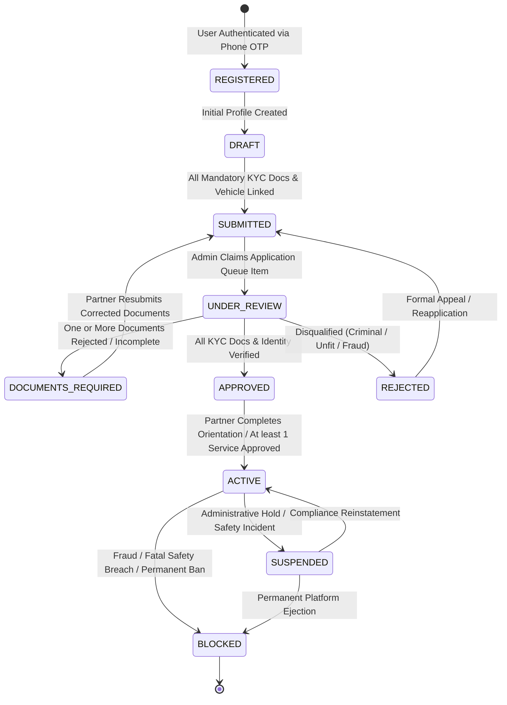
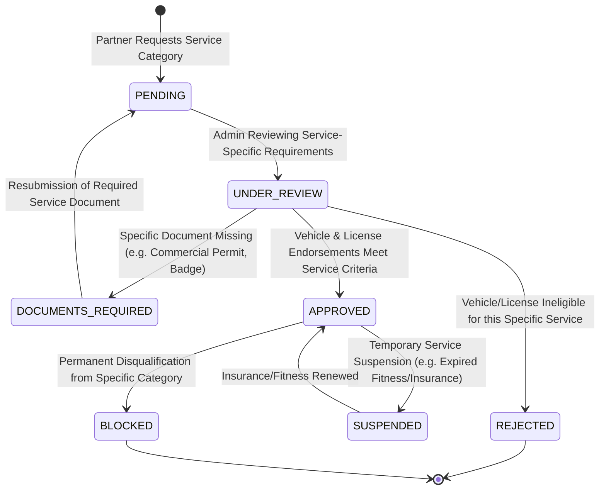
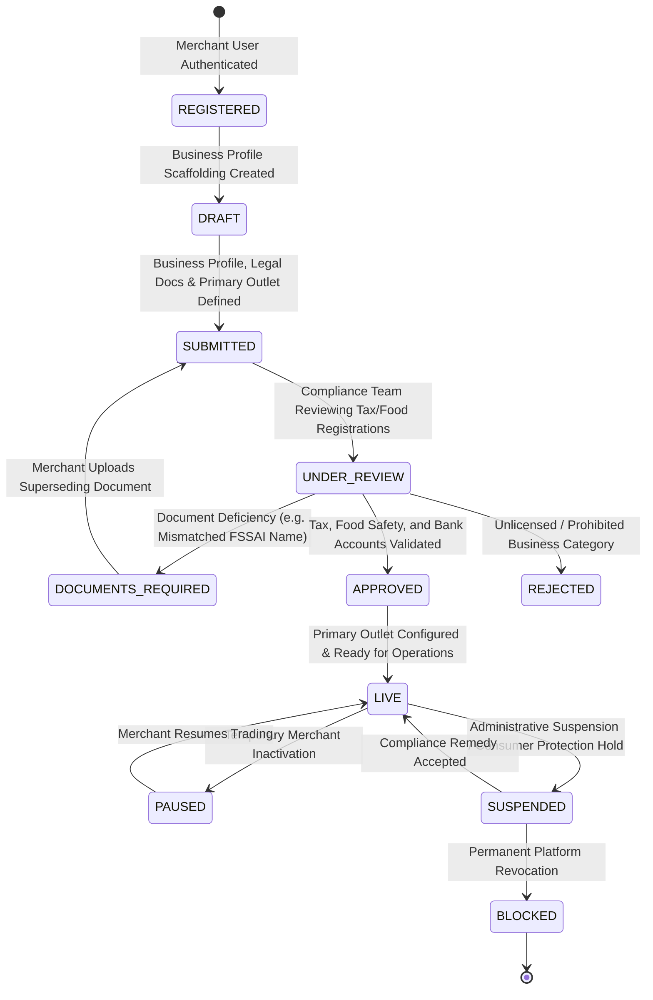
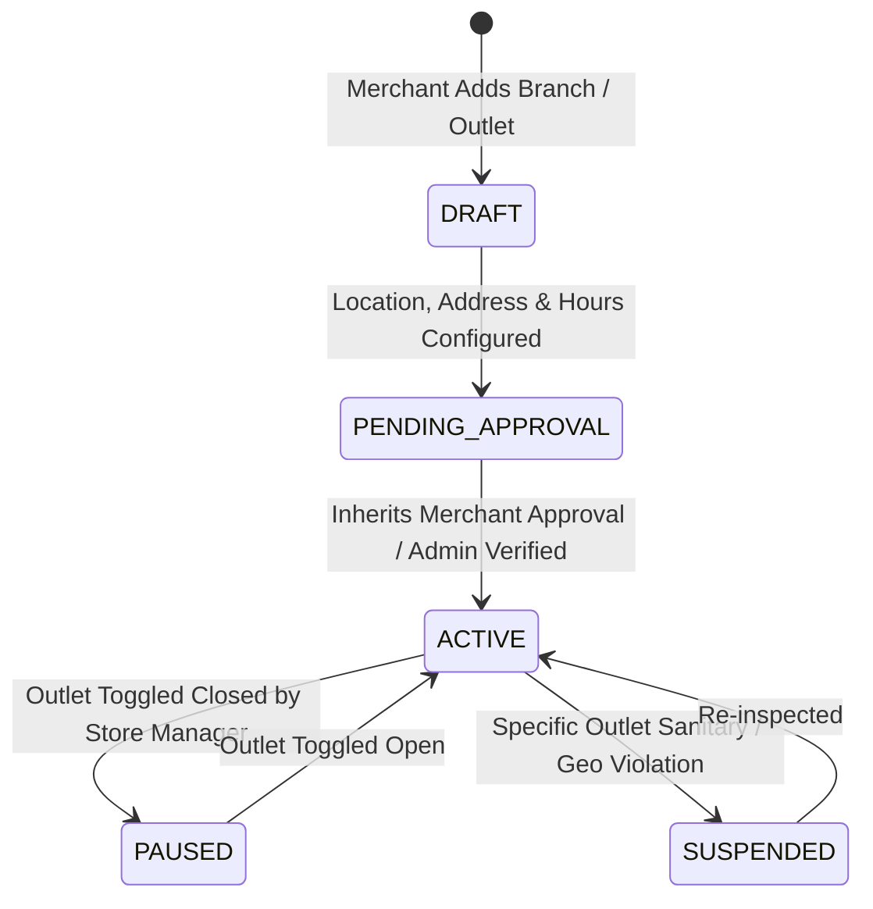

# ALLGO — PHASE 2 MASTER ENGINEERING EXECUTION PLAN (REFINED)
## Partner & Merchant Onboarding, KYC, Multi-Service Approval, Document Verification & Immutable Audit

> **STATUS:** PHASE 2 PLAN — REFINED, AWAITING EXPLICIT OWNER AUTHORIZATION.  
> **Target Baseline:** Phase 1 Verified (`5fe64927af3c97a37ae7b3da973761ec2ac54f91`)  
> **Workspace:** `E:\allgo`  
> **Branch:** `master`  
> **Scope:** Phase 2 ONLY (Delivery & Mobility Partner Onboarding, Multi-Service State Machines, Merchant Onboarding, Multi-Outlets, Secure Storage, Admin KYC Console)  
> **Freeze Policy:** Phase 0 is permanently frozen. Phase 1 accepted foundations preserved. Zero unapproved cloud spend.

---

## 1. ARCHITECTURAL OBJECTIVE & EXECUTIVE SUMMARY

Phase 2 builds the end-to-end onboarding, KYC document submission, versioned verification, multi-service eligibility gating, and administrative approval lifecycles for:
1. **Delivery & Mobility Partners:** Food delivery, grocery delivery, parcel courier, bike taxi, auto rickshaw, cab (sedan/hatchback/SUV), and hire-driver bookings.
2. **Merchants & Food Operators:** Restaurants, cloud kitchens, grocery stores, dark stores, and homemade-product sellers, with full multi-outlet management.
3. **Internal Compliance Administrators:** Real-time queue review, authenticated document inspection, per-service approval toggles, and immutable append-only audit logging.

All features are designed local-first, backed by PostgreSQL 16 + PostGIS 3.4, Redis 7.0, NestJS API architecture, Docker Flutter toolchains, and Next.js 16 (Turbopack) Admin console.

---

## 2. STATE-TRANSITION LIFECYCLE DIAGRAMS

### A. Partner Account Lifecycle State Machine
Governs the overall legal account standing of the partner.



### B. Partner Service-Specific Application Lifecycle State Machine
Each service category (`FOOD_DELIVERY`, `BIKE_TAXI`, `CAB_SEDAN`, etc.) operates on an **independent** state machine. Approval in one service **never** automatically authorizes another.



#### Service-Specific Requirement Matrix:
| Service Category | Permitted Vehicle Types | Mandatory Document Requirements |
|---|---|---|
| **FOOD_DELIVERY** | `BICYCLE`, `MOTORCYCLE`, `SCOOTER`, `AUTO_RICKSHAW` | Driving License (if motorized), Vehicle RC, Selfie |
| **GROCERY_DELIVERY** | `BICYCLE`, `MOTORCYCLE`, `SCOOTER`, `AUTO_RICKSHAW` | Driving License (if motorized), Vehicle RC, Selfie |
| **PARCEL_COURIER** | `MOTORCYCLE`, `SCOOTER`, `AUTO_RICKSHAW` | Driving License, Vehicle RC, Selfie |
| **BIKE_TAXI** | `MOTORCYCLE`, `SCOOTER` | Transport Endorsed DL, Commercial Helmet Proof, RC, Active Insurance |
| **AUTO_RICKSHAW** | `AUTO_RICKSHAW` | Commercial 3-Wheeler DL, Auto Permit, Fitness Certificate, RC, Insurance |
| **CAB_SEDAN / HATCH / SUV** | `CAB_SEDAN`, `CAB_HATCHBACK`, `CAB_SUV` | Commercial Light Motor Vehicle (LMV-TR) License, Taxi Permit, Fitness, Commercial Insurance |
| **HIRE_DRIVER** | *No vehicle required (operates customer car)* | Minimum 3-Year Commercial Driving License, Police Verification Report, Eye Test Certificate |

### C. Merchant & Outlet Lifecycle State Machines



#### Outlet State Machine (Multi-Outlet Management):


---

## 3. SECURE DOCUMENT STORAGE & RETENTION DESIGN

### A. Server-Side Filename Generation & Path Traversal Prevention
1. **Filename Generation:** Client filenames are strictly stripped of all path separators (`/`, `\`), directory tags, and control characters. Storage filenames are synthesized on the server using cryptographically secure UUIDv4 and sanitized extension:
   ```typescript
   const safeExtension = ALLOWED_MIME_EXT_MAP[verifiedMimeType]; // e.g. '.pdf', '.jpg', '.png'
   const storageKey = `${crypto.randomUUID()}${safeExtension}`;
   const storagePath = path.resolve(BASE_PRIVATE_STORAGE_DIR, storageKey);
   ```
2. **Path Traversal Guard:** The resolved storage path is explicitly verified to reside within `BASE_PRIVATE_STORAGE_DIR`:
   ```typescript
   if (!storagePath.startsWith(BASE_PRIVATE_STORAGE_DIR + path.sep)) {
     throw new BadRequestException('Illegal storage path traversal attempt');
   }
   ```
3. **Private Directory Boundary:** All files are written to `storage/private/kyc/` outside the web root, Next.js public directory, and API static assets. Direct HTTP access is completely blocked at the OS and reverse proxy layers.

### B. Streaming Upload Limits & Content Signature Inspection
1. **Streaming Size Limit:** Files are piped through a strict `StreamSizeLimitValidator` that aborts upload and destroys file streams if size exceeds **5,242,880 bytes (5MB)** before memory exhaustion.
2. **Magic-Byte Signature Verification:** Files are inspected for genuine binary headers before database commitment. Client-provided `Content-Type` headers are untrusted:
   - **PDF:** `0x25 0x50 0x44 0x46` (`%PDF`)
   - **JPEG:** `0xFF 0xD8 0xFF`
   - **PNG:** `0x89 0x50 0x4E 0x47 0x0D 0x0A 0x1A 0x0A`
   - Any file failing magic-byte inspection (e.g. polyglot executables, embedded shell scripts, SVG XML) is rejected immediately with `422 Unprocessable Entity` and deleted from disk.

### C. Authenticated Streaming & Ownership Authorization
- Document download endpoint: `GET /v1/documents/:id/download`
- **Authorization Enforcement:**
  1. Authenticates active session via `JwtAuthGuard`.
  2. Queries document record by UUID. If not found -> `404 Not Found`.
  3. Verifies ownership:
     - For `partner_documents`: authenticated `userId` must match `partners.user_id`.
     - For `merchant_documents`: authenticated `userId` must match `merchants.owner_id`.
     - Or authenticated user possesses authoritative `ADMIN` role context.
  4. If ownership check fails -> `403 Forbidden` (logged as potential IDOR attempt).
  5. Content is streamed with headers:
     - `Content-Type: <verified_mime_type>`
     - `Content-Disposition: attachment; filename="<sanitized_original_filename>"`
     - `X-Content-Type-Options: nosniff`
     - `Cache-Control: private, no-cache, no-store, must-revalidate`

### D. Filesystem Permissions & Orphan Cleanup
1. **OS Permissions:** Local storage directories are initialized with restricted permissions (`0700` directory, `0600` files on POSIX; restricted ACLs on Windows).
2. **Orphan Cleanup:** Files uploaded but not linked to a finalized application within 24 hours are scanned by a scheduled cleanup task and unlinked safely.
3. **Safe Deletion & Retention Policy:**
   - Active KYC documents are retained for the lifetime of the partner/merchant agreement plus **7 years** to satisfy Indian commercial, tax, and transport statutory requirements.
   - Upon formal account termination and expiration of statutory retention, files are securely wiped using randomized byte overwriting before unlinking.

---

## 4. SENSITIVE INFORMATION HANDLING & DATA MINIMIZATION

To comply with the Indian Digital Personal Data Protection (DPDP) Act 2023, Aadhaar Regulations, and RBI guidelines:

### A. Aadhaar Data Minimization
- **Strict Policy:** Full 12-digit Aadhaar numbers and unredacted Aadhaar card images are **strictly prohibited** from storage.
- If Aadhaar is used for address/identity proof:
  - Users are instructed to upload **Masked Aadhaar** showing only the last 4 digits.
  - Backend validation accepts only masked format: `XXXX-XXXX-1234` or DigiLocker verification token reference.
  - The first 8 digits are never collected, stored, or accepted.

### B. Encryption at Rest for Sensitive Banking & Tax Identifiers
- Bank Account Numbers, Bank IFSC, PAN Numbers, and UPI VPAs are encrypted at rest using **AES-256-GCM** with an application-level key (`ENCRYPTION_KEY_SECRET`) before inserting into PostgreSQL.
- Authenticated decryption occurs strictly inside service boundaries when needed for settlement verification.

### C. Response Masking
- Sensitive identifiers are masked in all standard API responses and Admin UI tables:
  - Bank Account: `XXXXXXXXXX4567` (last 4 digits only)
  - PAN: `ABCDE****F` (first 5 and last 1 characters only)
  - UPI ID: `s****@okhdfcbank`
- Only authorized Admin compliance officers with specific `SENSITIVE_DATA_VIEW` permission can view decrypted values, which triggers an audit log entry.
- **Zero Sensitive Logging:** Application logs strictly redact phone numbers (`+91****0001`), document storage paths, PANs, bank accounts, and OTPs.

---

## 5. VERSIONED DOCUMENT HISTORY & REVIEW TRAIL

Replacing a rejected or deficient document must **never** erase the historical submission or reviewer decisions.

### Schema Design for Versioning:
Every document table includes:
- `id UUID PRIMARY KEY`
- `version INTEGER NOT NULL DEFAULT 1`
- `is_current BOOLEAN NOT NULL DEFAULT TRUE`
- `superseded_by UUID REFERENCES ...`
- `verification_status VARCHAR(32) NOT NULL DEFAULT 'PENDING'`
- `rejection_reason TEXT`
- `reviewed_by UUID REFERENCES users(id)`
- `reviewed_at TIMESTAMPTZ`

### Resubmission Workflow:
```
[Original Document v1 Uploaded] ──▶ Status: PENDING
               │
      (Admin Review Decision)
               │
               ▼
[Document v1 Rejected] ──────────▶ Status: REJECTED, Reason: "FSSAI blur, expiry unreadable"
               │
    (Merchant / Partner Resubmits)
               │
               ▼
[Superseding Document v2 Created]─▶ Document v1 set to is_current = FALSE, superseded_by = doc_v2.id
                                   Document v2 set to is_current = TRUE, version = 2, status = PENDING
```
- Admins can toggle between current and historical versions in the audit dossier to inspect progression and avoid repeating rejected submissions.

---

## 6. IMMUTABLE APPEND-ONLY AUDIT BEHAVIOR

### A. Transactional Integrity
Every status transition (partner approval, merchant rejection, service suspension, document verification) is executed within a database transaction:
```sql
BEGIN;
  -- 1. Update domain entity
  UPDATE partners SET status = 'APPROVED', updated_at = NOW() WHERE id = $1;
  -- 2. Insert immutable audit event
  INSERT INTO audit_logs (
    actor_id, action, entity_name, entity_id, old_values, new_values, reason, created_at
  ) VALUES (
    $adminId, 'PARTNER_APPROVED', 'partners', $1, $oldJson, $newJson, $reason, NOW()
  );
COMMIT;
```

### B. Database-Level Mutation Prevention
Migration 003 installs an explicit trigger preventing `UPDATE` and `DELETE` on the `audit_logs` table:
```sql
CREATE OR REPLACE FUNCTION prevent_audit_log_mutation()
RETURNS TRIGGER AS $$
BEGIN
  RAISE EXCEPTION 'CRITICAL: audit_logs is an append-only table. Mutation or deletion is strictly prohibited.';
END;
$$ LANGUAGE plpgsql;

DROP TRIGGER IF EXISTS trg_prevent_audit_log_mutation ON audit_logs;
CREATE TRIGGER trg_prevent_audit_log_mutation
BEFORE UPDATE OR DELETE ON audit_logs
FOR EACH ROW EXECUTE FUNCTION prevent_audit_log_mutation();
```
- An automated test verifies that ordinary application queries cannot update or delete rows in `audit_logs`.

---

## 7. OWNERSHIP, AUTHORIZATION & IDOR PREVENTION MATRIX

| Endpoint | HTTP Method | Required Role | Ownership / Auth Scope | Error if Unauthorized |
|---|---|---|---|---|
| `/v1/partner/register` | `POST` | `PARTNER` / `CUSTOMER` | Creates/updates partner record bound to `req.user.id`. | `401 Unauthorized` |
| `/v1/partner/profile` | `GET` | `PARTNER` | Scoped to `WHERE user_id = req.user.id`. | `401 / 403` |
| `/v1/partner/services` | `POST` | `PARTNER` | Scoped to authenticated partner's profile. | `403 Forbidden` |
| `/v1/partner/vehicle` | `POST` | `PARTNER` | Validates partner ownership of vehicle. | `403 Forbidden` |
| `/v1/partner/documents` | `POST` | `PARTNER` | Attaches document to authenticated partner record. | `403 Forbidden` |
| `/v1/partner/submit` | `POST` | `PARTNER` | Validates partner status is `DRAFT` or `DOCUMENTS_REQUIRED`. | `403 Forbidden` |
| `/v1/merchants/register` | `POST` | `MERCHANT` / `USER` | Scoped to `req.user.id`. | `401 Unauthorized` |
| `/v1/merchants/profile` | `GET` | `MERCHANT_ADMIN` | Scoped to `WHERE owner_id = req.user.id`. | `403 Forbidden` |
| `/v1/merchants/documents` | `POST` | `MERCHANT_ADMIN` | Scoped to merchant owned by authenticated user. | `403 Forbidden` |
| `/v1/merchants/outlets` | `POST` | `MERCHANT_ADMIN` | Creates outlet for merchant owned by user. | `403 Forbidden` |
| `/v1/merchants/outlets/:id` | `GET/PUT` | `MERCHANT_ADMIN` | Checks `outlets.merchant_id == user.merchant.id`. | `403 Forbidden (IDOR Guard)` |
| `/v1/documents/upload` | `POST` | Authenticated User | Uploads binary, issues unlinked document ticket. | `401 Unauthorized` |
| `/v1/documents/:id/download`| `GET` | Owner or `ADMIN` | Strictly verifies entity ownership vs `req.user.id`. | `403 Forbidden (IDOR Guard)` |
| `/v1/admin/partners` | `GET` | `ADMIN` | Paginated queue with role verification. | `403 Forbidden` |
| `/v1/admin/partners/:id` | `GET` | `ADMIN` | Full partner compliance dossier. | `403 Forbidden` |
| `/v1/admin/partners/:id/status` | `PATCH` | `ADMIN` | Status transition with mandatory reason. | `403 Forbidden` |
| `/v1/admin/partners/:id/services/:sid` | `PATCH` | `ADMIN` | Independent service status transition. | `403 Forbidden` |
| `/v1/admin/partners/:id/documents/:did` | `PATCH` | `ADMIN` | Document approve/reject with mandatory note. | `403 Forbidden` |
| `/v1/admin/merchants/:id/status` | `PATCH` | `ADMIN` | Status transition with mandatory reason. | `403 Forbidden` |
| `/v1/admin/merchants/:id/documents/:did` | `PATCH` | `ADMIN` | Document approve/reject with mandatory note. | `403 Forbidden` |

### Concurrency & Conflict Prevention:
- Admin status updates and document reviews employ **row-level locking** (`SELECT ... FOR UPDATE`) or **optimistic concurrency checks** via `updated_at` timestamps to reject stale overwrites when two admins review the same dossier concurrently.

---

## 8. EIGHT-WORKSTREAM COORDINATION & FILE OWNERSHIP

To guarantee zero regression, preserve Phase 0/1, and prevent merge conflicts, the engineering team is organized into **eight specialized workstreams**:

```
┌────────────────────────────────────────────────────────────────────────┐
│                   PHASE 2 EIGHT-WORKSTREAM STRUCTURE                   │
├────┬─────────────────────────────┬───────────────────┬─────────────────┤
│ #  │ Workstream                  │ Primary Lead      │ Verification    │
├────┼─────────────────────────────┼───────────────────┼─────────────────┤
│ 1  │ Database & Migrations       │ DB Specialist     │ Schema & DDL    │
│ 2  │ Secure Storage & Crypto     │ Storage Specialist│ Magic-bytes & IO│
│ 3  │ Partner Backend Lifecycle   │ Partner BE Lead   │ APIs & States   │
│ 4  │ Merchant Backend Lifecycle  │ Merchant BE Lead  │ Docs & Outlets  │
│ 5  │ Partner Mobile Application  │ Flutter Partner   │ Wizard & Smoke  │
│ 6  │ Merchant Mobile Application │ Flutter Merchant  │ Uploads & Outlets│
│ 7  │ Admin Web Console           │ Next.js Admin     │ Turbopack & UI  │
│ 8  │ Security, Integration & QA  │ QA & Security Lead│ Independent Test│
└────┴─────────────────────────────┴───────────────────┴─────────────────┘
```

### Shared-File Ownership & Coordination Rules:
1. **`apps/api/src/app.module.ts`**:
   - *Owner:* Workstream 8 (QA & Security Lead integrates all modules).
   - Workstreams 2, 3, and 4 prepare self-contained NestJS modules (`StorageModule`, `PartnerModule`, `MerchantModule`) and provide export manifests.
2. **`packages/mobile_shared/lib/src/api/api_client.dart`**:
   - *Owner:* Workstream 5 (Partner Mobile) and Workstream 6 (Merchant Mobile).
   - Changes are partitioned: Workstream 5 adds Partner methods; Workstream 6 adds Merchant/Outlet methods; Workstream 2 adds `uploadDocument()` multipart method.
3. **`apps/admin/src/components/Sidebar.tsx`**:
   - *Owner:* Workstream 7 (Admin Web Console). Adds Partner Approvals navigation item.
4. **Frozen Phase 0 Files (`docs/`, `infra/terraform/`, `database/migrations/001_initial_schema.sql`, `002_postgis_indexes.sql`)**:
   - **PERMANENTLY FROZEN.** Zero agent may edit or regenerate these files.

---

## 9. DATABASE MIGRATION SPECIFICATION (003_phase2_kyc_and_onboarding.sql)

File path: `database/migrations/003_phase2_kyc_and_onboarding.sql`  
*Additive only — zero modification of existing 001/002 migrations.*

```sql
-- Migration 003: Phase 2 KYC, Merchant Documents, Partner Services & Immutability Triggers

-- 1. Create merchant_documents table with versioning
CREATE TABLE IF NOT EXISTS merchant_documents (
    id UUID PRIMARY KEY DEFAULT gen_random_uuid(),
    merchant_id UUID NOT NULL REFERENCES merchants(id) ON DELETE CASCADE,
    document_type VARCHAR(50) NOT NULL,
    document_number_masked VARCHAR(50),
    file_path TEXT NOT NULL,
    file_name VARCHAR(255) NOT NULL,
    mime_type VARCHAR(100) NOT NULL,
    file_size_bytes INTEGER NOT NULL,
    version INTEGER NOT NULL DEFAULT 1,
    is_current BOOLEAN NOT NULL DEFAULT TRUE,
    superseded_by UUID REFERENCES merchant_documents(id),
    verification_status VARCHAR(32) NOT NULL DEFAULT 'PENDING',
    rejection_reason TEXT,
    reviewed_by UUID REFERENCES users(id),
    reviewed_at TIMESTAMPTZ,
    created_at TIMESTAMPTZ NOT NULL DEFAULT NOW(),
    updated_at TIMESTAMPTZ NOT NULL DEFAULT NOW(),
    CONSTRAINT chk_merchant_doc_status CHECK (verification_status IN ('PENDING', 'VERIFIED', 'REJECTED')),
    CONSTRAINT chk_merchant_doc_type CHECK (document_type IN (
        'PAN_CARD', 'FSSAI_LICENSE', 'GSTIN_CERTIFICATE', 'BANK_PASSBOOK',
        'SHOP_ESTABLISHMENT_LICENSE', 'STORE_FACADE_PHOTO', 'KITCHEN_PHOTO',
        'OWNER_ID_PROOF', 'CANCELLED_CHEQUE'
    ))
);

-- 2. Create partner_service_applications table for multi-service state machine
CREATE TABLE IF NOT EXISTS partner_service_applications (
    id UUID PRIMARY KEY DEFAULT gen_random_uuid(),
    partner_id UUID NOT NULL REFERENCES partners(id) ON DELETE CASCADE,
    service_type VARCHAR(50) NOT NULL,
    status VARCHAR(32) NOT NULL DEFAULT 'PENDING',
    rejection_reason TEXT,
    reviewed_by UUID REFERENCES users(id),
    reviewed_at TIMESTAMPTZ,
    created_at TIMESTAMPTZ NOT NULL DEFAULT NOW(),
    updated_at TIMESTAMPTZ NOT NULL DEFAULT NOW(),
    UNIQUE (partner_id, service_type),
    CONSTRAINT chk_partner_service_status CHECK (status IN (
        'PENDING', 'UNDER_REVIEW', 'DOCUMENTS_REQUIRED', 'APPROVED', 'REJECTED', 'SUSPENDED', 'BLOCKED'
    )),
    CONSTRAINT chk_partner_service_type CHECK (service_type IN (
        'FOOD_DELIVERY', 'GROCERY_DELIVERY', 'PARCEL', 'BIKE_TAXI',
        'AUTO_RICKSHAW', 'CAB_SEDAN', 'CAB_HATCHBACK', 'CAB_SUV', 'HIRE_DRIVER'
    ))
);

-- 3. Enhance partner_documents with versioning and physical file metadata
ALTER TABLE partner_documents
    ADD COLUMN IF NOT EXISTS file_name VARCHAR(255),
    ADD COLUMN IF NOT EXISTS mime_type VARCHAR(100),
    ADD COLUMN IF NOT EXISTS file_size_bytes INTEGER,
    ADD COLUMN IF NOT EXISTS version INTEGER NOT NULL DEFAULT 1,
    ADD COLUMN IF NOT EXISTS is_current BOOLEAN NOT NULL DEFAULT TRUE,
    ADD COLUMN IF NOT EXISTS superseded_by UUID REFERENCES partner_documents(id),
    ADD COLUMN IF NOT EXISTS reviewed_by UUID REFERENCES users(id);

-- 4. Audit Log Immutability Trigger
CREATE OR REPLACE FUNCTION prevent_audit_log_mutation()
RETURNS TRIGGER AS $$
BEGIN
    RAISE EXCEPTION 'CRITICAL: audit_logs is an append-only table. Mutation or deletion is strictly prohibited.';
END;
$$ LANGUAGE plpgsql;

DROP TRIGGER IF EXISTS trg_prevent_audit_log_mutation ON audit_logs;
CREATE TRIGGER trg_prevent_audit_log_mutation
BEFORE UPDATE OR DELETE ON audit_logs
FOR EACH ROW EXECUTE FUNCTION prevent_audit_log_mutation();

-- 5. Performance Indexes
CREATE INDEX IF NOT EXISTS idx_merchant_docs_merchant ON merchant_documents(merchant_id, is_current);
CREATE INDEX IF NOT EXISTS idx_merchant_docs_status ON merchant_documents(verification_status);
CREATE INDEX IF NOT EXISTS idx_partner_services_partner ON partner_service_applications(partner_id);
CREATE INDEX IF NOT EXISTS idx_partner_services_status ON partner_service_applications(status);
CREATE INDEX IF NOT EXISTS idx_partner_docs_partner ON partner_documents(partner_id, is_current);
CREATE INDEX IF NOT EXISTS idx_partners_status ON partners(status);
CREATE INDEX IF NOT EXISTS idx_merchants_status ON merchants(status);
CREATE INDEX IF NOT EXISTS idx_outlets_merchant ON outlets(merchant_id);
```

---

## 10. ACCEPTANCE CRITERIA & VERIFICATION COMMANDS

Every Phase 2 requirement carries explicit verifiable acceptance criteria:

### A. Database Verification
- **Command:** `node --experimental-transform-types scripts/run-migrations.ts`
- **Criteria:** Migration `003_phase2_kyc_and_onboarding.sql` executes and commits cleanly; `_allgo_migrations` records 3 applied migrations; trigger prevents deletion from `audit_logs`.

### B. Document Storage & Security Verification
- **Command:** `node --experimental-transform-types --test tests/backend/storage-security.spec.ts`
- **Criteria:**
  - File larger than 5MB triggers streaming abort and returns `413 Payload Too Large`.
  - File with invalid magic bytes (e.g. `.exe` disguised as `.pdf`) rejected with `422 Unprocessable Entity`.
  - Non-owner streaming attempt returns `403 Forbidden`.
  - Authenticated owner or Admin streams file with proper `Content-Disposition`.
  - Path traversal attempts (`../../etc/passwd`) rejected.

### C. Partner Onboarding & Service Lifecycles Verification
- **Command:** `node --experimental-transform-types --test tests/backend/partner-lifecycle.spec.ts`
- **Criteria:**
  - Partner registers profile -> status `DRAFT`.
  - Partner applies for `FOOD_DELIVERY` and `BIKE_TAXI` -> both enter `PENDING`.
  - Partner uploads DL and Vehicle RC -> links to partner.
  - Partner submits application -> status transitions to `SUBMITTED`.
  - Admin approves `FOOD_DELIVERY` but rejects `BIKE_TAXI` (missing commercial badge) -> states reflect independently.
  - Partner cannot activate `BIKE_TAXI` while unapproved.
  - Resubmission of rejected badge creates version 2 document, preserving version 1 and rejection history.
  - Audit log records all state changes with acting admin ID and reason.

### D. Merchant Documents & Multi-Outlet Verification
- **Command:** `node --experimental-transform-types --test tests/backend/merchant-documents-and-outlets.spec.ts`
- **Criteria:**
  - Merchant uploads PAN, FSSAI, Bank passbook -> saved in `merchant_documents`.
  - Category compliance check: Restaurant requires FSSAI; Grocery allows registration without FSSAI if non-food.
  - Merchant creates secondary outlet -> persisted in `outlets` table with spatial location.
  - Cross-merchant outlet update rejected with `403 Forbidden` (IDOR check).
  - Admin verifies individual documents and approves merchant.

### E. Flutter Mobile Tests
- **Command:** Docker Flutter container test across modules:
  - `docker run --rm -v "E:\allgo:/app" -w /app/packages/mobile_shared ghcr.io/cirruslabs/flutter:3.24.5 flutter test`
  - `docker run --rm -v "E:\allgo:/app" -w /app/apps/partner_mobile ghcr.io/cirruslabs/flutter:3.24.5 flutter test`
  - `docker run --rm -v "E:\allgo:/app" -w /app/apps/merchant_mobile ghcr.io/cirruslabs/flutter:3.24.5 flutter test`
- **Criteria:** All mobile unit and widget smoke tests pass cleanly (0 failures).

### F. Next.js Admin Build & Route Verification
- **Command:** `npm run build -w @allgo/admin`
- **Criteria:** Turbopack builds `/admin/partners`, `/admin/partners/[id]`, `/admin/merchants`, and `/admin/merchants/[id]` with 0 TypeScript or lint errors.

### G. Full Monorepo Regression & Phase 0 Freeze Check
- **Command:**
  - `npm test` (all 262 Phase 1 tests + all Phase 2 tests pass, 0 failures).
  - `git diff --stat 5fe64927af3c97a37ae7b3da973761ec2ac54f91 -- docs/ infra/terraform/ database/migrations/001_initial_schema.sql database/migrations/002_postgis_indexes.sql database/seeds/ scripts/cost-calculator.ts` (strictly 0 diffs).

---

## 11. REQUIRED PHASE 2 FINAL DELIVERABLES

Upon completion, eight deliverables will be produced:
1. `PHASE_2_IMPLEMENTATION_REPORT.md`
2. `PHASE_2_TEST_REPORT.md`
3. `PHASE_2_SECURITY_REVIEW.md`
4. `PHASE_2_API_CHANGES.md`
5. `PHASE_2_DATABASE_CHANGES.md`
6. `PHASE_2_ACCEPTANCE_REPORT.md`
7. `PHASE_2_DOCUMENT_RETENTION_POLICY.md`
8. `PHASE_2_AUDIT_TRAIL_VERIFICATION.md`

---

## 12. STATUS & OWNER GATE

```
╔═══════════════════════════════════════════════════════════════════════════════════╗
║                                                                                   ║
║   STATUS: PHASE 2 PLAN — REFINED, AWAITING EXPLICIT OWNER AUTHORIZATION.          ║
║                                                                                   ║
║   Implementation is on hold. Zero source files will be modified until explicit     ║
║   authorization is granted by the project owner.                                  ║
║                                                                                   ║
╚═══════════════════════════════════════════════════════════════════════════════════╝
```
