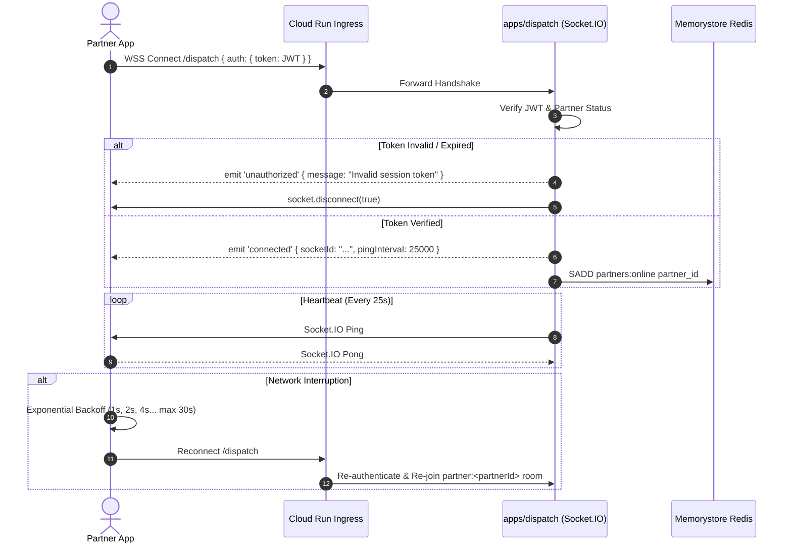

# Real-Time WebSocket Event Specifications

## 1. Overview & Architectural Principles

The AllGo real-time event pipeline powers sub-second live GPS tracking, dynamic dispatch, and instantaneous order lifecycle updates across the Customer, Partner, and Merchant mobile applications. 

The real-time layer is hosted within the `apps/dispatch` microservice using **Socket.IO** backed by the **Socket.IO Redis Adapter** and **Google Cloud Memorystore for Redis 7.0**. This architecture enables stateless Cloud Run container instances to scale horizontally from zero to dozens of instances without losing client socket session awareness or room broadcast reach.

---

### Core Invariant: Zero Location Writes to Firestore

A foundational rule of the AllGo infrastructure is **Zero location writes to Firestore**:

```
[Partner Mobile App]
      │
      │ WSS /dispatch (Adaptive GPS: 3–5s active, 15–30s idle)
      ▼
[apps/dispatch (Cloud Run)]
      │
      ├──► Updates Redis GEO Index (`GEOADD partners:active:geo <lng> <lat> <partnerId>`)
      ├──► Broadcasts via Socket.IO Redis Adapter (`room: delivery_leg:<id>`) ──► [Customer App]
      └──► Buffers to Redis Stream (`XADD stream:partner:locations`)
                 │
                 ▼ (Every 30s Micro-Batch Flush)
           [PostGIS (partner_location_history)]
```

#### Why Zero Firestore Location Writes?
1. **Cost Explosion Prevention:** Writing GPS coordinates every 3–5 seconds per courier to Google Cloud Firestore would generate upwards of 20,000 document writes per hour for just 25 active couriers. At commercial scale, this causes catastrophic billing inflation.
2. **Database Thrashing Mitigation:** Cloud SQL and PostGIS are optimized for spatial relation queries and indexed polygon evaluations, not 1,000 writes/sec point thrashing. High-frequency coordinates live in Memorystore Redis memory.
3. **Dispute & Audit Persistence via PostGIS:** Historical location breadcrumbs are appended to a Redis Stream and flushed in batched multi-row `INSERT` statements to `partner_location_history` every 30 seconds by a background worker for audit, safety disputes, and route playback.

---

## 2. Socket.IO Namespaces & Room Hierarchy

Socket.IO connections are partitioned into two isolated namespaces:

| Namespace | Primary Consumer | Purpose | Handshake Authentication |
| :--- | :--- | :--- | :--- |
| `/tracking` | Customer App, Merchant App | Live courier map tracking, ETA countdowns, and order status updates | Bearer JWT via handshake `auth.token` |
| `/dispatch` | Partner App | Real-time GPS ping streaming, job offer dispatching, acceptance, and navigation | Bearer JWT via handshake `auth.token` (Partner role verified) |

### Room Scopes:
- **`order_group:<orderGroupId>`**: Joined by the customer upon placing an order group. Receives aggregated sub-order updates.
- **`delivery_leg:<deliveryLegId>`**: Joined by the customer and merchant tracking an active delivery courier.
- **`partner:<partnerId>`**: Private room for an individual courier or driver. Receives direct job offers and dispatch commands.
- **`zone:<zoneId>`**: Joined by dispatch nodes for regional broadcast notices.

---

## 3. Real-Time Event Catalog

### Summary Table

| Event Name | Namespace | Direction | Frequency / Cadence | Description |
| :--- | :--- | :--- | :--- | :--- |
| `location:ping` | `/dispatch` | Client $\rightarrow$ Server | 3–5s (active), 15–30s (idle) | Partner emits high-frequency GPS coordinate breadcrumb |
| `partner:location` | `/tracking` | Server $\rightarrow$ Client | 3–5s (synchronized with partner pings) | Dispatches updated courier position to customer map marker |
| `order:status_updated` | `/tracking` | Server $\rightarrow$ Client | Event-driven on state transition | Notifies customer/merchant of order lifecycle phase change |
| `job:offer` | `/dispatch` | Server $\rightarrow$ Client | Event-driven (Dispatch engine) | Dispatches new multi-vertical job offer (20s timeout window) |
| `job:offer_timeout` | `/dispatch` | Server $\rightarrow$ Client | 20s after unaccepted offer | Informs partner that unaccepted job offer has expired |
| `job:accepted` | `/dispatch` | Bidirectional | Event-driven upon partner tap | Partner commits to job; server returns navigation plan |
| `route:deviation_detected` | `/dispatch` | Server $\rightarrow$ Client / Internal | Triggered if $> 100$m off-route ($60$s cooldown) | Courier has deviated from cached polyline; prompts re-route |

---

### Detailed Event Payloads & Schemas

#### 1. `location:ping`
- **Namespace:** `/dispatch`
- **Direction:** Client (Partner App) $\rightarrow$ Server (`apps/dispatch`)
- **Cadence:**
  - **Active Job:** Emitted every **3–5 seconds** while status is `ASSIGNED`, `ARRIVED_PICKUP`, `PICKED_UP`, or `OUT_FOR_DELIVERY`.
  - **Idle Online:** Emitted every **15–30 seconds** when online awaiting offers.
  - **Offline:** 0 pings (socket disconnected).

```typescript
export interface LocationPingPayload {
  partner_id: string;              // UUID of the authenticated delivery partner
  latitude: number;                // WGS84 latitude (-90.0 to 90.0)
  longitude: number;               // WGS84 longitude (-180.0 to 180.0)
  speed_kph: number | null;        // Instantaneous ground speed in km/h
  bearing: number | null;          // Compass heading in degrees (0.0 to 359.9)
  accuracy_meters: number;         // GPS horizontal dilution of precision (e.g., 5.0)
  active_job_id?: string | null;   // UUID of active partner_job or delivery_leg
  battery_level?: number;          // Battery percentage (0-100)
  timestamp: string;               // ISO 8601 UTC timestamp
}
```

- **Server Action:**
  1. Executes `GEOADD partners:active:geo <longitude> <latitude> <partner_id>`.
  2. Evaluates distance deviation against cached route polyline.
  3. If `active_job_id` is present, forwards sanitized coordinate to Socket.IO room `delivery_leg:<active_job_id>` as `partner:location`.
  4. Appends event to Redis Stream `stream:partner:locations` for PostGIS batch writing.

---

#### 2. `partner:location`
- **Namespace:** `/tracking`
- **Direction:** Server (`apps/dispatch`) $\rightarrow$ Client (Customer App)
- **Room Target:** `delivery_leg:<deliveryLegId>` or `order_group:<orderGroupId>`
- **Cadence:** Emitted every 3–5 seconds during active delivery legs.

```typescript
export interface PartnerLocationPayload {
  delivery_leg_id: string;         // UUID of active delivery leg
  partner_id: string;              // Masked UUID of delivery partner
  latitude: number;                // Current courier latitude
  longitude: number;               // Current courier longitude
  bearing: number | null;          // Courier heading for vehicle marker orientation
  speed_kph: number | null;        // Instantaneous speed for dead reckoning
  eta_seconds: number;             // Remaining estimated transit time to drop-off
  interpolated: boolean;           // True if smoothed via dead reckoning
  timestamp: string;               // ISO 8601 UTC timestamp
}
```

- **Client Action:** Smoothly animates customer vehicle map marker along the pre-fetched cached Google Routes polyline using velocity dead reckoning between successive 3–5s pings.

---

#### 3. `order:status_updated`
- **Namespace:** `/tracking`
- **Direction:** Server (`apps/dispatch` / `apps/api`) $\rightarrow$ Client (Customer & Merchant)
- **Room Target:** `order_group:<orderGroupId>`

```typescript
export interface OrderStatusUpdatedPayload {
  order_group_id: string;          // UUID of parent order container
  sub_order_id?: string;           // UUID of merchant sub-order (if sub-order change)
  vertical_type: 'FOOD' | 'GROCERY' | 'PARCEL' | 'RIDE' | 'HIRE_DRIVER' | 'HOME_MADE';
  from_status: string | null;      // Previous status enum
  to_status: string;                // Updated status enum
  status_display_text: {
    en: string;                    // English user-friendly status banner
    ta: string;                    // Tamil localized status banner
  };
  prep_time_remaining_minutes?: number; // Countdown clock for merchant food prep
  estimated_ready_at?: string;     // ISO 8601 timestamp
  updated_at: string;              // ISO 8601 UTC timestamp
}
```

- **Supported Sub-Order Status Transitions:**
  - `PLACED` $\rightarrow$ `PAYMENT_CONFIRMED` $\rightarrow$ `MERCHANT_ACCEPTED` $\rightarrow$ `PREPARING` $\rightarrow$ `READY` $\rightarrow$ `PARTNER_ASSIGNED` $\rightarrow$ `PARTNER_AT_STORE` $\rightarrow$ `PICKED_UP` $\rightarrow$ `OUT_FOR_DELIVERY` $\rightarrow$ `ARRIVED` $\rightarrow$ `DELIVERED` (or `CANCELLED`).

---

#### 4. `job:offer`
- **Namespace:** `/dispatch`
- **Direction:** Server (`apps/dispatch`) $\rightarrow$ Client (Partner App)
- **Room Target:** `partner:<partnerId>`
- **Cadence:** Dispatched on demand when order or ride needs courier assignment.
- **Timeout Window:** Strict **20s** acceptance window.

```typescript
export interface JobOfferPayload {
  job_id: string;                  // UUID in partner_jobs table
  job_type: 'DELIVERY_LEG' | 'PARCEL' | 'RIDE' | 'HIRE_BOOKING';
  vertical: 'FOOD' | 'GROCERY' | 'PARCEL' | 'RIDE' | 'HIRE_DRIVER';
  fulfillment_mode: 'SEPARATE' | 'DELIVER_TOGETHER';
  pickup: {
    name: string;                  // Store or passenger name
    address: string;               // Readable street address
    latitude: number;
    longitude: number;
    distance_km: number;           // Distance from partner current position
  };
  stops: Array<{
    stop_sequence: number;
    stop_type: 'PICKUP' | 'DROPOFF';
    merchant_name?: string;
    address: string;
    latitude: number;
    longitude: number;
  }>;
  drop: {
    address: string;
    latitude: number;
    longitude: number;
  };
  total_distance_km: number;       // Route distance
  estimated_earnings_inr: number;  // Guaranteed earnings for completing job
  timeout_seconds: 20;             // Count-down timer ceiling (20 seconds)
  expires_at: string;              // ISO 8601 UTC expiration timestamp
}
```

---

#### 5. `job:offer_timeout`
- **Namespace:** `/dispatch`
- **Direction:** Server (`apps/dispatch`) $\rightarrow$ Client (Partner App)
- **Room Target:** `partner:<partnerId>`
- **Trigger:** Fired exactly when the 20-second offer countdown window expires without the partner tapping "Accept".

```typescript
export interface JobOfferTimeoutPayload {
  job_id: string;                  // UUID of the expired job offer
  reason: 'TIMEOUT_EXPIRED' | 'REASSIGNED_TO_ANOTHER_PARTNER';
  timestamp: string;               // ISO 8601 UTC timestamp
}
```

- **Client Action:** Dismisses the full-screen offer modal, sounds gentle decline haptic, and returns to idle map view.

---

#### 6. `job:accepted`
- **Namespace:** `/dispatch`
- **Direction:** Bidirectional:
  - Client $\rightarrow$ Server: Partner requests job acceptance within 20s.
  - Server $\rightarrow$ Client: Dispatch acknowledges assignment and returns navigation metadata.

```typescript
// Client Request Payload:
export interface JobAcceptedRequest {
  job_id: string;                  // UUID of job offer
  partner_id: string;              // UUID of accepting partner
  partner_latitude: number;        // Current GPS position at time of acceptance
  partner_longitude: number;
}

// Server Response Acknowledgement:
export interface JobAcceptedResponse {
  job_id: string;
  status: 'ACCEPTED';
  active_vertical_lock: 'FOOD' | 'GROCERY' | 'PARCEL' | 'RIDE' | 'HIRE_DRIVER';
  route_polyline: string;          // Cached Google Routes encoded polyline
  pickup_contact_phone: string;    // Masked phone number (Exotel)
  handover_otp_required: boolean;  // True if drop-off requires OTP verification
  accepted_at: string;             // ISO 8601 UTC timestamp
}
```

- **Server Action:**
  1. Executes transactional row-level lock on `partner_jobs WHERE id = :job_id AND status = 'OFFERED' AND expires_at > NOW()`.
  2. Sets `partner_modes.active_vertical_lock = job.vertical` enforcing Section 5B mutual exclusion.
  3. Transitions status to `ACCEPTED`.

---

#### 7. `route:deviation_detected`
- **Namespace:** `/dispatch`
- **Direction:** Server (`apps/dispatch`) $\rightarrow$ Client (Partner App) / Internal Alert
- **Room Target:** `partner:<partnerId>`
- **Threshold Constraints:**
  - Distance deviation: Courier location is $> 100$ meters perpendicular distance from the cached polyline.
  - Time cooldown: At least **60 seconds** have elapsed since the last Google Routes API query.

```typescript
export interface RouteDeviationDetectedPayload {
  delivery_leg_id: string;         // UUID of active delivery leg
  partner_id: string;              // UUID of partner
  current_location: {
    latitude: number;
    longitude: number;
  };
  deviation_distance_meters: number; // Computed displacement (must exceed 100m)
  last_recalculated_at: string;     // ISO 8601 timestamp (must exceed 60s cooldown)
  recalculated_route?: {
    encoded_polyline: string;      // New Google Routes polyline
    new_eta_seconds: number;
    distance_remaining_meters: number;
  };
  timestamp: string;               // ISO 8601 UTC timestamp
}
```

- **Client Action:** Redraws polyline on partner in-app turn-by-turn navigation without causing map flashing or redundant network queries.

---

## 4. Connection Lifecycle & Quality of Service



### Connection Rules:
1. **Heartbeat Cadence:** Ping interval = 25 seconds; ping timeout = 20 seconds.
2. **Reconnection Policy:** Mobile clients use exponential backoff with random jitter starting at 1s, capped at **30 seconds maximum backoff**.
3. **Session Resumption:** On reconnect, the client re-authenticates and seamlessly re-subscribes to its active order and leg rooms without loss of tracking state.
