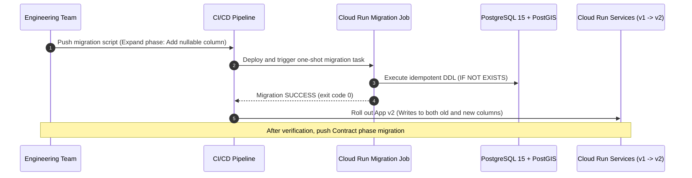

# AllGo Database Backup, Restore & Migration Strategy

## 1. Executive Summary

This document establishes the operational procedures for database backups, Point-in-Time Recovery (PITR), disaster recovery drills, and zero-downtime database schema migrations for PostgreSQL 15 + PostGIS.

---

## 2. Backup Strategy & Retention Schedules

| Backup Type | Mechanism | Schedule | Retention | Storage Class |
| :--- | :--- | :--- | :--- | :--- |
| **Automated Snapshots** | Native Cloud SQL Storage Snapshot | Daily at 02:00 IST | 7 days | Standard Zonal Storage |
| **Point-in-Time Recovery** | Continuous WAL Archiving | Continuous (Real-time) | 7 days (Granular to second) | High-performance Archive |
| **Logical Offsite Dump** | `pg_dump` via Cloud Storage Export | Weekly (Sunday 03:00 IST) | 30 days | Cloud Storage Coldline (asia-south1) |
| **Disaster Recovery Replica** | Regional HA Multi-Zone | Synchronous Replication | Live Standby | asia-south1-b |

### Deletion Protection Enforced:
Production Cloud SQL instances strictly mandate `deletion_protection = true` in Terraform. No console user or automated script can delete the production database without first performing a dual-authenticated code change.

---

## 3. Schema Migration Strategy & Zero-Downtime Expand-Contract

AllGo strictly forbids breaking migrations that require application downtime or table-locking operations during trading hours.

### The Expand-Contract Workflow:

### Mandatory Migration Coding Standards:
1. **Idempotence:** Every migration must be safely re-runnable without errors:
   - Use `CREATE TABLE IF NOT EXISTS`
   - Use `CREATE INDEX IF NOT EXISTS`
   - Use `DO $$ ... EXCEPTION WHEN duplicate_object THEN ... $$;` for types/enums.
2. **Non-Blocking Indexing:** Use `CONCURRENTLY` for index creation on active production tables (`CREATE INDEX CONCURRENTLY IF NOT EXISTS ...`) to prevent table-level write locks.
3. **No Destructive Drops:** `DROP TABLE` or `DROP COLUMN` commands are strictly forbidden in standard deployment migrations. Deprecated columns must be retained for at least two deployment cycles.
4. **Pre-Deployment Verification:** All migrations are tested in CI against a test database with simulated production volume before deployment approval.
