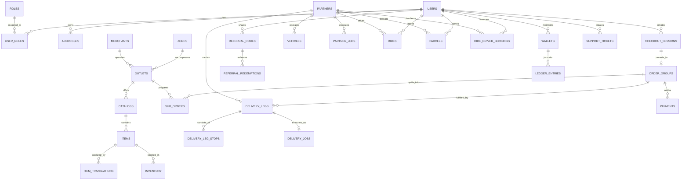

# AllGo Domain Model & Business Glossary

## 1. Executive Overview

AllGo is a multi-vertical Indian super-app platform providing hyperlocal commerce (Food, Grocery), intra-city courier (Parcels), passenger mobility (Bike-taxi, Auto, Cab), and designated driver booking (Hire-Driver).

This document establishes the canonical domain model, entity relationships, and ubiquitous business glossary governing backend microservices, data persistence, and client interfaces.

---

## 2. Canonical Business Glossary

| Term | Technical Concept | Business Definition |
| :--- | :--- | :--- |
| **OrderGroup** | Root aggregation entity (`order_groups`) | A customer's single checkout transaction, which may span multiple distinct outlets and merchants. |
| **SubOrder** | Outlet-specific split (`sub_orders`) | A single merchant outlet's portion of an OrderGroup, processed independently by the merchant kitchen/store. |
| **DeliveryLeg** | Fulfillment assignment (`delivery_legs`) | The routing and physical transit unit assigned to a delivery partner. In Mode A, 1 leg per sub-order; in Mode B, 1 combined leg with multiple pickups. |
| **Mode A (Separate)** | Standard parallel dispatch | Independent couriers assigned simultaneously to separate outlets in a multi-merchant order. |
| **Mode B (Combined)** | JIT bundled delivery | A single courier picks up from multiple merchant outlets within a 1.5 km corridor and delivers to the customer together. |
| **JIT Dispatch** | Just-in-Time partner paging | Deferring courier assignment until the merchant confirms prep time minus courier travel time, preventing courier idle wait. |
| **PartnerJob** | Unified partner feed entity (`partner_jobs`) | Vertical-agnostic assignment offered to a delivery or mobility partner with a 20-second acceptance SLA. |
| **Double-Entry Ledger** | Balanced journal entries (`ledger_entries`) | Append-only financial bookkeeping where every debit has an equal and opposite credit. Zero account tampering permitted. |
| **TCS / TDS** | Tax Withheld (`tax_rules`) | Mandatory Indian statutory tax withheld at source: 1% GST TCS (Section 52 CGST Act) and 1% Income Tax TDS (Section 194-O). |
| **COD Reconciliation** | Cash collection balancing | Physical cash collected by couriers, debited against their partner wallet balance with daily ceiling enforcement. |
| **Deadhead Chaining** | Proximity dispatch optimization | Offering a courier or driver their next task near their current delivery dropoff before completing the active trip. |

---

## 3. Entity Relationship Diagram (ERD)

### Table Nomenclature Reconciliation
The physical PostgreSQL database schema matches the domain model entities with the following canonical table names:
- **`delivery_jobs`**: Implements fulfillment tracking and execution state for delivery legs/jobs (`delivery_jobs` created in `005_phase4_dispatch_and_delivery.sql`).
- **`support_tickets`**: Tracks customer and partner dispute and grievance tickets (`support_tickets` created in `001_initial_schema.sql`).
- **`hire_driver_bookings`**: Manages reservations for professional chauffeurs (`hire_driver_bookings` created in `001_initial_schema.sql`).
- **`referral_codes` & `referral_redemptions`**: Manages viral acquisition tokens, tracking, abuse detection, and referral rewards (`013_phase_f_features.sql`).

---

## 4. Multi-Role Identity & Lifecycle Guarantees

1. **Identity Unification:** A user is uniquely identified by an E.164 phone number (`+91XXXXXXXXXX`). A single user record can simultaneously hold `CUSTOMER`, `PARTNER`, and `MERCHANT_OPERATOR` roles in `user_roles`.
2. **Context Separation:** Client requests must explicitly specify an `X-Active-Role` context header. A driver cannot accept customer orders while operating under the `PARTNER` session context.
3. **Immutability Invariant:** Financial transactions and lifecycle order events (`order_events`, `ledger_entries`) are strictly append-only. No SQL `UPDATE` or `DELETE` operations are permitted under any role or service account.

