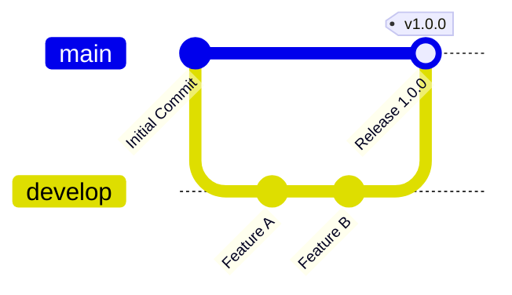

# AllGo Environment Separation & Tiering Architecture

## 1. Executive Summary

AllGo enforces strict architectural separation between non-production (`dev`) and production (`prod`) environments. Under zero circumstances are database instances, cache stores, VPC networks, or secret versions shared across environment boundaries.

---

## 2. Environment Comparison & Resource Matrix

| Dimension | Development (`dev`) | Production Pilot (`prod`) | Architectural Justification |
| :--- | :--- | :--- | :--- |
| **GCP Project** | `allgo-dev` (Separate project) | `allgo-prod` (Separate project) | Complete IAM and billing account boundary isolation. |
| **GCP Region** | `asia-south1` (Mumbai) | `asia-south1` (Mumbai) | Compliance with Indian data residency; lowest latency. |
| **Cloud SQL Tier** | `db-f1-micro` (Shared core) | `db-custom-2-7680` (2 vCPU, 7.5 GiB) | Production handles connection pooling and spatial queries. |
| **Cloud SQL HA** | Zonal (Single-zone) | **Regional HA** (Multi-zone failover) | Automatic failover to Zone B if Zone A suffers outage. |
| **PostgreSQL PITR** | 7 days automated backups | **7 days Point-in-Time Recovery (PITR)** | Continuous WAL archiving allows point-in-time restoration. |
| **Deletion Protection** | Optional | **MANDATORY (`deletion_protection = true`)** | Prevents accidental Terraform or console destruction. |
| **Memorystore Redis** | Basic M1 (1 GiB, $0.049/hr) | **Standard M2 HA (5 GiB, $0.054/hr)** | Multi-zone replica with automatic failover for dispatch. |
| **Cloud Run Instances** | `min_instances = 0` (Scale to 0) | `min_instances = 1` (`api`, `dispatch`) | Eliminates cold start latency on dispatch matching. |
| **Overnight Shutdown**| **Active (12 hrs/day off: 21:00-09:00)**| **DISABLED (24/7 continuous operation)** | Saves ~50% compute costs on non-production environment. |
| **Monthly GCP Spend** | **₹6,356 / month** ($67.33 USD) | **₹52,823 / month** ($559.56 USD) | Detailed in `docs/cost/monthly-cost-estimate-inr.md`. |

---

## 3. Network Isolation & Direct VPC Egress

Both environments utilize Direct VPC Egress (`vpc-egress = all-traffic`) rather than legacy Serverless VPC Access connectors:
- **Cost Reduction:** Eliminates minimum connector instance costs ($16.80/mo per connector).
- **Subnet Separation:**
  - `dev-vpc`: `10.10.0.0/20` (Subnet: `10.10.1.0/24`)
  - `prod-vpc`: `10.20.0.0/20` (Subnet: `10.20.1.0/24`)
- **Internal Private Services Access (PSA):** Dedicated `/24` peered ranges for Cloud SQL and Memorystore private IPs. Zero public IPs exposed to the internet.

---

## 4. Branching & Continuous Delivery Promotion Strategy

1. **Development Pipeline (`develop` branch):**
   - Merges trigger automated linting, type-checks, and test suite execution.
   - On green build, image built and deployed to `allgo-dev` Cloud Run services.
2. **Production Pipeline (`main` branch):**
   - Direct pushes to `main` are strictly blocked via branch protection rules.
   - Requires pull request approval by at least one engineering lead.
   - Terraform production changes require explicit manual `terraform apply` with human review of the generated plan.
   - Production database migrations must execute via zero-downtime backward-compatible migration steps.
