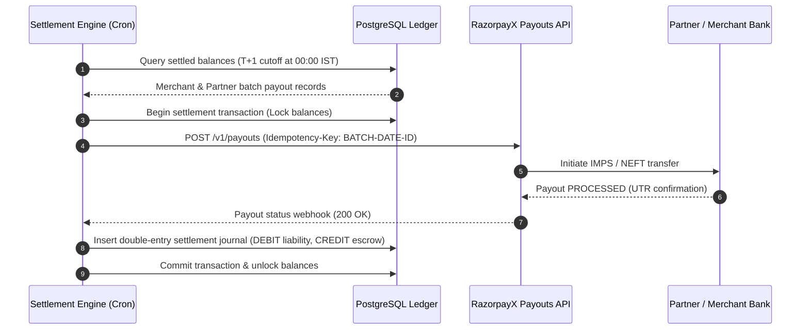

# AllGo Financial Ledger & Settlement Architecture

## 1. Executive Summary & Core Financial Invariants

AllGo implements an append-only, double-entry financial bookkeeping engine. Every monetary movement across customers, merchants, delivery partners, payment gateways, and tax authorities is recorded as a balanced transaction journal in PostgreSQL.

### Core Architectural Invariants:
1. **Zero-Sum Balance Rule:** For every `transaction_reference`, the sum of all DEBIT entries must exactly equal the sum of all CREDIT entries (`Σ(Debits) == Σ(Credits)`).
2. **Append-Only Immutability:** Financial ledger entries can never be modified or deleted. An immutable database trigger (`trg_ledger_entries_immutable`) rejects any `UPDATE` or `DELETE` attempt at the database engine level.
3. **Corrections via Reversals:** If a financial error occurs, a compensating reversing journal entry must be appended with full audit metadata.
4. **Deferred Constraint Verification:** Transaction balance is verified at transaction `COMMIT` time via `trg_ledger_entries_balance_check` (`DEFERRABLE INITIALLY DEFERRED`), allowing multi-line atomic inserts within a single database transaction.

---

## 2. Chart of Accounts

| Account Code | Account Type | Normal Balance | Description |
| :--- | :--- | :---: | :--- |
| `1010` | `GATEWAY_ESCROW` | Asset (Debit) | Funds captured and held by payment gateway (Razorpay) pending nodal settlement. |
| `2010` | `CUSTOMER_WALLET` | Liability (Credit) | Stored monetary value held on behalf of customers for instant checkout and refunds. |
| `2020` | `MERCHANT_SETTLEMENT` | Liability (Credit) | Net funds owed to merchant outlets for completed food/grocery sub-orders. |
| `2030` | `PARTNER_EARNINGS` | Liability (Credit) | Payouts and bonuses earned by delivery couriers and mobility drivers. |
| `2040` | `TAX_PAYABLE_GST` | Liability (Credit) | Statutory Goods & Services Tax collected on platform commissions and delivery fees. |
| `2050` | `TAX_WITHHELD_TCS` | Liability (Credit) | 1% GST Tax Collected at Source (Section 52 CGST Act) withheld from merchant net sales. |
| `2060` | `TAX_WITHHELD_TDS` | Liability (Credit) | 1% Section 194-O Income Tax Withheld from ecommerce participants. |
| `4010` | `PLATFORM_COMMISSION` | Revenue (Credit) | AllGo's net commission revenue from merchant sales. |
| `4020` | `PLATFORM_DELIVERY_FEES` | Revenue (Credit) | Platform surcharge or customer delivery fees retained by the platform. |

---

## 3. Double-Entry Accounting Examples

### 3.1 Scenario A: Customer Places ₹500 Order (Prepaid via UPI)
- Items Total: ₹400
- Packaging Fee: ₹20
- Delivery Fee: ₹50
- Platform Fee: ₹5
- GST on Fees (18% on ₹75): ₹13.50
- Total Customer Paid: ₹488.50

**Journal Entry (`REF-ORD-1001`):**
| Account Type | Direction | Amount (INR) | Explanation |
| :--- | :---: | :---: | :--- |
| `GATEWAY_ESCROW` | **DEBIT** | ₹488.50 | Inflow into Razorpay escrow nodal account |
| `MERCHANT_SETTLEMENT` | **CREDIT** | ₹336.00 | Net merchant payout (₹400 items + ₹20 pack - 20% commission ₹84) |
| `PARTNER_EARNINGS` | **CREDIT** | ₹45.00 | Courier delivery fee payout |
| `PLATFORM_COMMISSION` | **CREDIT** | ₹84.00 | Merchant commission (20% of ₹420) |
| `PLATFORM_DELIVERY_FEES` | **CREDIT** | ₹10.00 | Retained platform delivery margin (₹50 customer fee - ₹45 courier + ₹5 fee) |
| `TAX_PAYABLE_GST` | **CREDIT** | ₹9.50 | 18% GST on platform margin & convenience fee |
| `TAX_WITHHELD_TCS` | **CREDIT** | ₹4.00 | 1% GST TCS on merchant net sales |
| **Total Debits:** | **₹488.50** | **Total Credits:** | **₹488.50** (Balanced: Invariant Satisfied) |

---

### 3.2 Scenario B: Cash on Delivery (COD) Order Collection
When a courier collects ₹300 cash from the customer:
1. `CUSTOMER_WALLET` or settlement is balanced.
2. Courier's partner wallet is **DEBITED** by ₹300 (they now owe the platform ₹300).
3. Courier's partner wallet is **CREDITED** by ₹50 for their delivery wage.
4. Net partner wallet impact: -₹250 (deducted from their weekly settlement payout or settled via UPI QR code when reaching the ₹2,000 cash ceiling).

---

## 4. Settlement & Payout Engine (RazorpayX Integration)

### Settlement Schedules:
- **Merchants:** Daily T+1 batch settlement via NEFT/IMPS. Minimum settlement threshold: ₹500.
- **Partners (Couriers/Drivers):** Weekly automated payout on Tuesdays; optional Instant Withdrawal (max 3 times/day, ₹5 fee per instant transfer).
- **Withholding Compliance:** Monthly export of Form GSTR-8 (TCS) and Form 26Q (TDS) generated directly from immutable ledger records.

