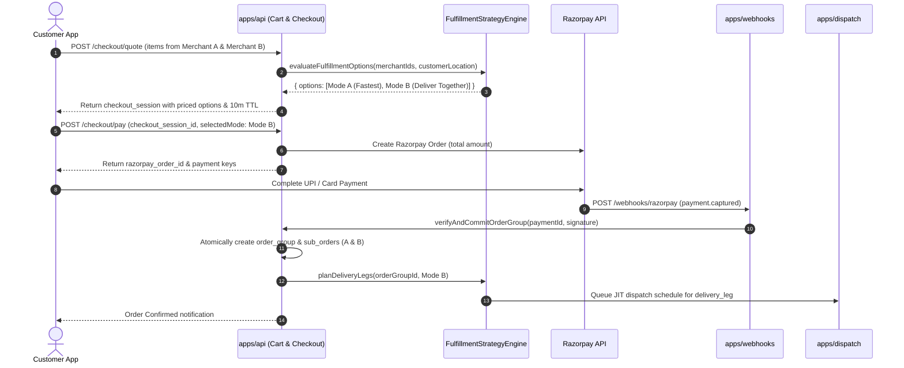
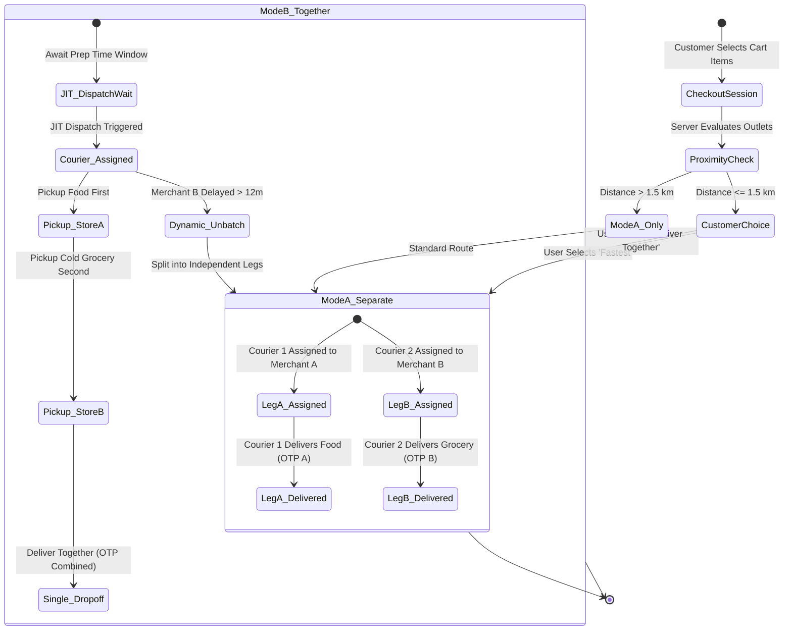

# Section 5A: Unified Cart, Checkout & Dual Fulfillment Strategy

## 1. Overview & Data Hierarchy

The AllGo checkout and fulfillment architecture enables customers to add items from multiple merchants across diverse verticals (e.g. restaurant food + grocery store items) into a single persistent shopping cart and complete checkout with one unified payment.

### Order Decomposition Hierarchy

```
checkout_session  ──>  order_group  ──>  sub_orders  ──>  delivery_legs
```

- **`checkout_session`:** An ephemeral quote holding item snapshots, inventory soft reservations, server-computed fees, GST calculations, and discounts. Locked with a 10-minute validity TTL.
- **`order_group`:** The persistent parent record generated upon payment confirmation. Corresponds 1:1 with the customer payment transaction and Razorpay order ID.
- **`sub_order`:** One independent order record per merchant outlet. Maintains its own state machine (`MERCHANT_ACCEPTED`, `PREPARING`, `READY`), independent B2B/B2C GST invoices, and merchant settlement accounts.
- **`delivery_leg`:** Physical fulfillment unit carrying pickup/drop waypoints, courier assignment, telemetry, and partner payout.



---

## 2. Pluggable Fulfillment Strategy Engine (`FulfillmentStrategyEngine`)

Fulfillment is abstracted behind a pluggable TypeScript interface:

```typescript
export interface FulfillmentStrategyEngine {
  evaluateEligibility(
    merchants: MerchantOutletLocation[],
    customerLocation: GeoCoordinate
  ): Promise<FulfillmentEligibilityResult>;

  createDeliveryPlan(
    orderGroup: OrderGroupEntity,
    selectedMode: FulfillmentMode
  ): Promise<DeliveryPlanResult>;

  evaluateUnbatching(
    deliveryLegId: string,
    subOrders: SubOrderEntity[]
  ): Promise<UnbatchDecision>;
}
```

### 2.1 Mode A: Separate Deliveries (Baseline)
- **Concept:** Every `sub_order` receives an independent courier and independent `delivery_leg`.
- **Applicability:** Single-merchant orders, merchants separated by $> 1.5$ km, or when the customer explicitly selects "Fastest Delivery".
- **Tracking:** The customer app shows distinct map pins, independent tracking streams, and separate delivery verification OTPs for each courier.

### 2.2 Mode B: Deliver Together (Batched Multi-Merchant)
- **Concept:** A single courier handles pickups from both merchants and delivers them in a single drop-off to the customer.
- **Proximity Gating:** Mode B is presented at checkout **only if** the Euclidean/road distance between Merchant A and Merchant B is $\le 1.5$ km. If the distance exceeds 1.5 km, Mode B is disabled in the UI with a clear explanatory notice.
- **Discount Incentive:** Customers receive a discounted delivery fee (e.g. ₹20–₹35 lower than two separate deliveries) reflecting operational fuel and courier efficiency.
- **Courier Equipment Verification:** Assigned couriers must have a verified insulated carrier bag with hot and cold compartment separation on record in `partners.equipment_verified`.

---

## 3. Just-in-Time (JIT) Delayed Dispatch & Perishability Sequencing

To prevent hot food from sitting on a counter or cold groceries from melting:

### 1. Perishability Pickup Sequencing:
- Pickups are strictly ordered based on vertical perishability:
  1. **First Pickup:** Food / Kitchen preparation (hot cooked food packed in thermal insulation).
  2. **Last Pickup:** Cold / Frozen Groceries (packaged immediately before the courier departs for the customer).

### 2. JIT Delayed Courier Dispatch:
- If Merchant A (Restaurant) reports an estimated preparation time of 25 minutes, and Merchant B (Grocery) requires 5 minutes packing time:
  $$\text{Courier Dispatch Delay} = \text{Estimated Ready Time (Food)} - \text{Estimated Courier Travel Time to Store A}$$
- The courier is not summoned immediately upon order creation; Cloud Tasks triggers courier discovery only when Store A is within 7 minutes of marking `READY`.

---

## 4. Operational Failure Modes & Edge-Case Lifecycles

### Dynamic Unbatching Fallback on Merchant Delay
If Store A marks `READY` on schedule, but Store B enters unexpected delay (e.g., preparation delay exceeds configurable threshold $\Delta t > 12$ minutes):
1. **Unbatch Trigger:** `FulfillmentStrategyEngine.evaluateUnbatching()` triggers dynamic unbatching.
2. **State Transition:** The existing batched `delivery_leg` is pruned to retain only Store A $\rightarrow$ Customer. A new independent `delivery_leg` is spawned for Store B and queued for independent courier dispatch.
3. **Billing Protection:** The customer is notified in-app. The platform absorbs any difference so the customer is **not charged two full delivery fees** due to merchant operational delays.

### Merchant Rejection or Item Stockout
If one merchant rejects or times out:
1. The rejected `sub_order` transitions to `CANCELLED`.
2. A partial refund is immediately triggered via Razorpay for the exact value of the cancelled sub-order (items + pro-rata taxes + merchant-specific packaging).
3. The remaining active `sub_order` continues uninterrupted under Mode A fulfillment with the assigned courier.


