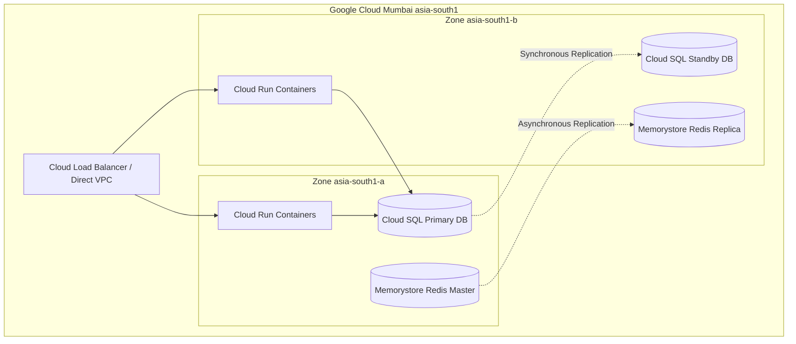

# AllGo Observability & Disaster Recovery Architecture

## 1. Executive Summary

AllGo operates real-time mission-critical dispatch, payment, and mobility services. This specification details centralized telemetry (logging, metrics, tracing), proactive threshold alerting, and high-availability disaster recovery (DR) protocols.

---

## 2. Telemetry & Observability Pipeline

### 2.1 Structured JSON Logging
All microservices (`api`, `dispatch`, `webhooks`, `admin`) output single-line JSON logs to `stdout`, automatically ingested by Google Cloud Logging via Google Cloud Run's native log forwarder.

**Standard Log Schema:**
```json
{
  "severity": "INFO",
  "message": "SubOrder status transitioned to PREPARING",
  "timestamp": "2026-11-05T14:30:00.123Z",
  "serviceContext": {
    "service": "api",
    "version": "1.0.0"
  },
  "logging.googleapis.com/trace": "projects/allgo-prod/traces/4bf92f3577b34da6a3ce929d0e0e4736",
  "logging.googleapis.com/spanId": "00f067aa0ba902b7",
  "context": {
    "userId": "usr_chennai_001",
    "orderGroupId": "grp_1001",
    "subOrderId": "sub_1001_a"
  }
}
```

### 2.2 Strict Zero-PII Invariant
The following sensitive data elements are masked or stripped prior to logging:
- Plaintext phone numbers (masked: `+91*****12345`).
- One-Time Passwords (OTPs) (strictly prohibited from all logs).
- Customer payment details, PAN, Aadhaar, bank account numbers, or CVVs.
- Customer delivery address coordinates (fuzzed to 2 decimal places in application logs).

---

## 3. Threshold Alerting Policies

| Alert Policy | Metric Target | Threshold & Condition | Notification Channel | Severity |
| :--- | :--- | :--- | :--- | :---: |
| **Budget Consumption 50%** | Cloud Billing Actual Spend | ≥ 50% of monthly forecast | Email to Finance & Ops | P3 |
| **Budget Consumption 80%** | Cloud Billing Actual Spend | ≥ 80% of monthly forecast | Slack `#alerts-ops` + Email | P2 |
| **Budget Consumption 100%**| Cloud Billing Actual Spend | ≥ 100% of monthly forecast | SMS + PagerDuty to Founder | **P1** |
| **5xx Error Rate Spike** | `run.googleapis.com/request_count` | > 1.0% of requests for 5 mins | PagerDuty On-Call Engineer | **P1** |
| **API High Latency** | `run.googleapis.com/request_latencies` | p95 > 500ms for 5 mins | Slack `#alerts-backend` | P2 |
| **Cloud SQL Connections** | `cloudsql.googleapis.com/connections` | > 80% max connections | Slack `#alerts-backend` | P2 |
| **Redis Memory Saturation** | `redis.googleapis.com/stats/memory` | > 80% memory used | Slack `#alerts-backend` | P2 |
| **Ledger Imbalance Attempt**| Custom Metric: Ledger Invariant Error | > 0 errors in 1 min | Immediate PagerDuty to Tech Lead | **P0** |

---

## 4. High Availability & Disaster Recovery (DR)

### 4.1 Objectives
- **Recovery Point Objective (RPO):** **< 5 minutes** (via PostgreSQL continuous Write-Ahead Log archiving / Point-in-Time Recovery).
- **Recovery Time Objective (RTO):** **< 30 minutes** (automated multi-zone database failover and automated container spin-up).

### 4.2 Multi-Zone High Availability Architecture


### 4.3 Failover & Recovery Playbooks
1. **Primary Zone Outage (`asia-south1-a` fails):**
   - Cloud SQL automatically fails over to the standby replica in `asia-south1-b` within 60 seconds.
   - Memorystore Redis automatically promotes the replica in `asia-south1-b` to master within 30 seconds.
   - Cloud Run containers in `asia-south1-b` absorb 100% of incoming traffic.
2. **Catastrophic Data Corruption Playbook:**
   - Engineer executes Point-in-Time Recovery (PITR) to a target timestamp preceding the corruption event:
     `gcloud sql instances clone allgo-prod-db allgo-prod-db-restored --point-in-time "2026-11-05T14:15:00Z"`.
   - Update Secret Manager database URL to the restored instance.
   - Restart Cloud Run services with zero data loss prior to corruption.
