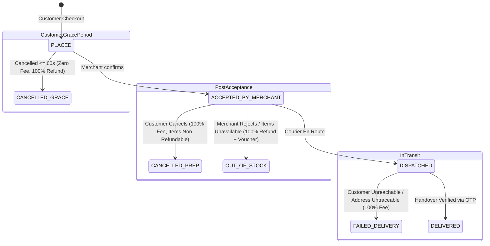

# AllGo Refunds, Cancellations & Cash on Delivery (COD) Architecture

## 1. Executive Summary

This specification governs the automated business logic, financial ledger postings, and state machine transitions for cancellations, refunds, and Cash on Delivery (COD) reconciliation across all AllGo verticals.

---

## 2. Order Cancellation Lifecycle & Fee Slabs

### Cancellation Fee & Compensation Policy:
1. **Customer Grace Period (≤ 60 seconds):**
   - Cancellation is 100% free with immediate full refund.
   - Merchant has not started food preparation; couriers have not been paged.
2. **Post-Acceptance Customer Cancellation:**
   - Customer is charged 100% of the food items total as a cancellation fee.
   - Merchant receives their net payout to compensate for consumed kitchen ingredients.
   - Delivery fee and platform fee refunded to customer if courier was not yet dispatched.
3. **Merchant Rejection / Store Out of Stock:**
   - 100% refund of all charges to customer.
   - Platform issues ₹50 apology credit to customer's wallet.
   - Merchant outlet penalized in internal reliability ranking algorithm.
4. **Section 5A Partial Cancellation (Multi-Outlet Orders):**
   - In a multi-outlet order (e.g., Outlet A + Outlet B), if Outlet B cannot fulfill, SubOrder B is cancelled and fully refunded.
   - SubOrder A continues to delivery uninterrupted.
   - In Mode B, the delivery leg dynamically unbatches to a single pickup run.

---

## 3. Refund Execution Architecture

### 3.1 Refund Destination Options
- **Instant Wallet Refund (Default / Recommended):**
  - Credited immediately to the customer's AllGo closed-loop wallet (< 500ms).
  - 100% success rate with zero banking gateway dependencies.
  - Immediately spendable on subsequent orders or rides.
- **Original Payment Method (PG Source):**
  - Executed via Razorpay Refunds API (`POST /v1/payments/{payment_id}/refund`).
  - Turnaround time: UPI (Instant to 2 hours), Cards/NetBanking (3 to 5 banking days).

### 3.2 Double-Entry Refund Ledger Posting
For a ₹300 refund to customer wallet:
| Account Type | Direction | Amount (INR) | Explanation |
| :--- | :---: | :---: | :--- |
| `GATEWAY_ESCROW` (or Platform) | **DEBIT** | ₹300.00 | Reverse liability / escrow deduction |
| `CUSTOMER_WALLET` | **CREDIT** | ₹300.00 | Customer wallet balance increased |

---

## 4. Cash on Delivery (COD) Rules & Cash Management

### 4.1 Order Limits & Risk Controls
- **Maximum Order Ceiling:** ₹1,500 for Food, ₹2,000 for Grocery.
- **Eligibility Filter:** COD is disabled if the user has < 1 successful delivery or > 1 delivery rejection in their last 5 orders.
- **Courier Cash-in-Hand Ceiling:** ₹2,000 maximum physical cash holding.

### 4.2 Courier Real-Time Cash Reconciliation Flow
1. **Cash Collection:** Courier collects physical cash from customer upon OTP handover.
2. **Instant Ledger Debit:** Courier's partner wallet is instantly debited by the exact order amount.
3. **Threshold Guard:**
   - If `partner_wallet.balance_inr + cash_collected > ₹2,000`:
   - System flags courier as `COD_SUSPENDED`.
   - Courier will only receive prepaid (online) jobs until cash is deposited.
4. **Cash Settlement via UPI Repayment:**
   - Courier opens Partner App -> "Deposit Collected Cash".
   - App generates a dynamic UPI QR code linked to AllGo's Razorpay virtual account.
   - Courier pays cash amount from their personal UPI app (PhonePe/GPay).
   - Razorpay webhook confirms payment -> Courier's partner wallet credited -> COD suspension lifted immediately.
