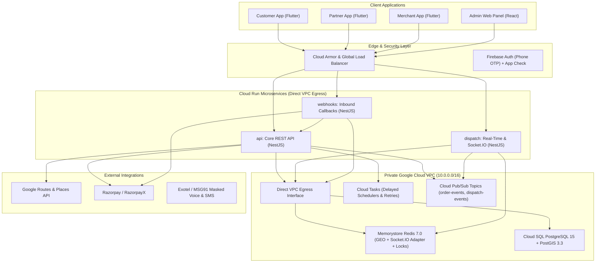
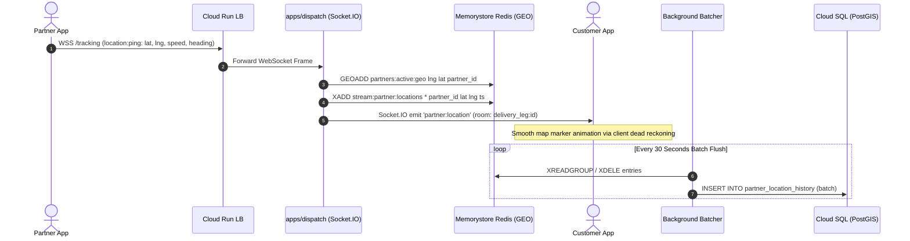

# System Architecture & Infrastructure Layout

## 1. Overview & Architectural Goals

The AllGo platform is architected as an event-driven, containerized microservices ecosystem hosted on Google Cloud Platform (GCP). It is engineered for high throughput, sub-second latency on real-time tracking, zero GPS coordinate writes to Firestore, strict multi-merchant order decomposition, and complete database-driven extensibility across Indian states.

### Core Architectural Invariants:
1. **Containerized Cloud Run Services:** Core logic is divided into three stateless container services (`apps/api`, `apps/dispatch`, `apps/webhooks`) communicating over Cloud Pub/Sub, Cloud Tasks, and Memorystore Redis.
2. **Direct VPC Egress:** Cloud Run containers access Cloud SQL (PostgreSQL + PostGIS) and Memorystore Redis via Direct VPC Egress with private IP connectivity (no public IP exposure for databases or caches).
3. **Low-Cost Real-Time Tracking (Approach A):** Live courier and trip tracking flows strictly through WebSocket connections into Redis GEO and Socket.IO Redis Adapter. Coordinates are never written to Firestore. Periodic audit coordinates are flushed to PostGIS via asynchronous background micro-batches.
4. **Single-Call Google Routes Pipeline:** Polylines and ETAs are fetched once at order/job assignment, cached in Redis with a 24-hour TTL keyed by origin-destination-waypoints hash. Live deviation detection enforces a 60-second cooldown and 100-meter minimum threshold before triggering recalculation.

---

## 2. Service Decomposition & Network Topology

---

## 3. Real-Time Tracking & Telemetry Pipeline

### Tracking Architecture (Zero Firestore Location Writes)
- **High-Frequency GPS Pings:** Delivery partners and drivers emit GPS coordinates every 3–5 seconds while on an active leg (15–30 seconds when idle) over persistent WebSocket connections to `apps/dispatch`.
- **Redis GEO Layer:** The `apps/dispatch` service processes inbound `location:ping` payloads and updates the partner position using Redis `GEOADD partners:active:geo <longitude> <latitude> <partner_id>`.
- **Socket.IO Room Broadcasting:** For tracking orders, subscribers (customers and merchants) join room `order_group:<id>` or `delivery_leg:<id>`. The dispatch node publishes position updates through Socket.IO with the `@socket.io/redis-adapter`.
- **PostGIS Batch Persistence:** Coordinates are appended to a Redis Stream buffer `stream:partner:locations`. A background worker flushes batched historical points into `partner_location_history` in PostGIS every 30 seconds for billing audits, disputes, and compliance, eliminating database write thrashing.

---

## 4. Google Maps Route Optimization Pipeline

To prevent severe Google Maps platform cost runaway:
1. **Single Directions API Call:** When an order transitions to `PARTNER_ASSIGNED`, the backend executes exactly one optimized Route request (covering Pickup $\rightarrow$ Drop or Multi-Pickup $\rightarrow$ Drop).
2. **Persistent Route Polyline Cache:** The encoded route polyline, steps, and baseline distance/duration are stored in Redis (`route:<order_id>`) with an expiration of 24 hours.
3. **Flapping & Jitter Guard:** 
   - Courier location deviation is computed against the cached polyline.
   - Recalculation is locked behind a strict dual threshold: distance deviation must exceed **100 meters** AND minimum elapsed time since last calculation must exceed **60 seconds**.
   - Minor traffic or GPS jitter updates only the interpolated ETA via simple velocity math, without re-querying Google Routes.

---

## 5. Security & Isolation Boundaries

- **Authentication:** Firebase Auth verifies mobile phone numbers via SMS OTP. Upon verification, the client exchanges the Firebase ID token for an AllGo session JWT signed with an asymmetric key pair stored in GCP Secret Manager.
- **Firebase App Check:** Integrated on Customer, Partner, and Merchant apps (Play Integrity on Android, DeviceCheck / App Attest on iOS) to block unauthorized bot traffic and emulators.
- **Direct VPC Egress & Service Accounts:** Cloud Run services run under dedicated least-privilege IAM service accounts (`sa-api@`, `sa-dispatch@`, `sa-webhooks@`). Direct VPC egress guarantees that all database and cache connections use RFC 1918 private IP addresses.

---

## 6. Database & Extension Compatibility (Cloud SQL)

- **PostgreSQL Version:** Cloud SQL for PostgreSQL 15 (`POSTGRES_15`, currently running 15.5+ in `asia-south1`).
  - Google Cloud SQL officially supports PostgreSQL 11 through 16. PostgreSQL 15 is selected as the production standard for enterprise connection stability, mature PostGIS integration, and optimal Cloud SQL High Availability replication.
- **PostGIS Version Matrix:**
  - Cloud SQL PostgreSQL 15 provides **PostGIS 3.3.2** (upgrading automatically with minor point updates to 3.4/3.5).
  - Spatial Extensions Installed:
    - `postgis` (Core spatial data types: geometry, geography, GiST/SP-GiST 2D/3D indexing).
    - `postgis_raster` (Raster spatial analysis).
    - `postgis_topology` (Topological spatial relationship models).
    - `address_standardizer` (Postal and street address parsing).
- **Cloud SQL Flags Configured:**
  - `cloudsql.enable_pg_bigm = "on"` (Multi-language 2-gram index search for Tamil and English menu item lookups).
  - `max_connections = 500` (Dev: 100, Prod: 500).

---

## 7. Configurable Parameters (Admin-Editable Per-City)

All thresholds are stored in the database (`city_settings` / `system_config`) and managed dynamically via the Admin Web Panel, rather than hardcoded in application logic.

| Parameter Key | Setting Description | Default Value | Unit | Admin Editable Scope |
| :--- | :--- | :--- | :--- | :--- |
| `route_deviation_distance_threshold_meters` | Minimum courier deviation displacement before triggering Google Routes re-calculation | `100` | meters | Per-city (`city_settings`) |
| `route_deviation_cooldown_seconds` | Minimum elapsed time cooldown between successive route recalculation requests | `60` | seconds | Per-city (`city_settings`) |
| `partner_gps_ping_interval_active_seconds` | WebSocket GPS ping interval for couriers/drivers on an active job | `4` | seconds | Per-city (`city_settings`) |
| `partner_gps_ping_interval_idle_seconds` | WebSocket GPS ping interval for couriers/drivers idle / awaiting offers | `20` | seconds | Per-city (`city_settings`) |
| `postgis_location_batch_flush_seconds` | Frequency for flushing partner coordinates from Redis Stream to PostGIS audit tables | `30` | seconds | Platform global (`system_config`) |
| `google_routes_cache_ttl_seconds` | Redis cache TTL for encoded polylines retrieved from Google Routes API | `86400` | seconds | Platform global (`system_config`) |
| `websocket_heartbeat_interval_seconds` | Ping-pong heartbeat cadence to keep mobile WebSocket connections alive | `25` | seconds | Platform global (`system_config`) |
| `websocket_reconnect_backoff_max_seconds` | Maximum exponential backoff cap for mobile client reconnection attempts | `30` | seconds | Platform global (`system_config`) |

